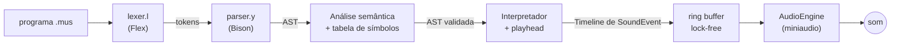

# Visão do Produto e Arquitetura

O Interpretador Musical (Grupo 03) é, na prática, um **compilador musical** para uma *Domain-Specific Language* (DSL). A arquitetura se apoia numa separação estrita de responsabilidades: de um lado, o núcleo do compilador (a lógica da linguagem); do outro, o motor de áudio (a geração do sinal sonoro).



## 1. O compilador (pré-processamento)

O núcleo do compilador, escrito em C++17 com Flex e Bison, não emite som nem executa instruções em tempo real. O processamento é em lote (*batch*):

1. **Leitura:** o compilador recebe o código-fonte inteiro (arquivo `.mus`).
2. **Análise léxica** (`lexer/lexer.l`): o Flex quebra o texto em tokens — comandos, notas, números, operadores —, registrando a linha e a coluna de cada um. A flag `--tokens` imprime essa tabela.
3. **Análise sintática** (`parser/parser.y`): o Bison valida a gramática e monta a **Árvore Sintática Abstrata** (AST, detalhada no documento de [Arquitetura e Design da AST]({{ site.baseurl }}) e definida em `src/interpreter/ast.h`). Um erro léxico ou sintático interrompe a compilação com a posição exata, antes de qualquer som.
4. **Análise semântica** (`src/semantic/`): percorre a AST preenchendo a **tabela de símbolos** — nome, tipo, escopo, endereço e posição de cada variável — e recusa uso de nome não declarado ou fora de escopo, troca de tipo numa reatribuição e operações entre tipos incompatíveis. A flag `--simbolos` imprime a tabela.
5. **Geração de eventos** (`src/interpreter/`): o interpretador percorre a AST e, com o **playhead**, produz uma **lista estática de eventos musicais temporizados** na memória, a `Timeline`. Ela é a representação intermediária do compilador, especificada em [Representação Intermediária]({{ site.baseurl }}).

Cada nota tocada vira um `SoundEvent` com:

* **`startTime`**: o instante, em segundos, em que o som começa;
* **`duration`**: por quanto tempo a nota soa;
* **`frequency`**: a altura da nota, em Hz;
* **`volume`**: a intensidade do som, de 0.0 a 1.0.

### Inspecionando a timeline: `--emit-timeline`

A flag `--emit-timeline` roda todas as fases acima e, em vez de tocar, imprime a `Timeline` em CSV na saída padrão. Não abre o dispositivo de áudio, então funciona em máquina sem placa de som e em CI. Se qualquer fase recusar o programa (erro léxico, sintático, semântico ou de execução), nada é impresso na saída padrão, as mensagens de erro vão para a saída de erro e o código de saída é 1.

```bash
./build/compilador -q --emit-timeline exemplos/arpejo.mus
```

```
indice,inicio_s,duracao_s,frequencia_hz,volume
1,0.000000,0.250000,261.625565,0.800000
2,0.250000,0.250000,329.627557,0.800000
3,0.500000,0.250000,391.995436,0.800000
...
13,3.000000,0.500000,391.995436,0.800000
14,3.500000,0.500000,0.000000,0.000000
```

O formato é um contrato, para que a mesma entrada produza sempre a mesma saída, em qualquer sistema:

| Coluna | Conteúdo | Unidade |
|---|---|---|
| `indice` | posição do evento, a partir de 1 | — |
| `inicio_s` | `startTime` | segundos |
| `duracao_s` | `duration` | segundos |
| `frequencia_hz` | `frequency` | Hz |
| `volume` | `volume` | 0.0 a 1.0 |

* **Ordem:** pelo instante de início. Eventos que começam no mesmo instante mantêm a ordem em que o programa os agendou (ordenação estável). É a mesma ordem em que os eventos são entregues ao motor de áudio.
* **Precisão:** seis casas decimais fixas em todas as colunas (microssegundos nos tempos), sempre com ponto como separador decimal.
* **Pausas:** uma `pausa` aparece como um evento silencioso, com frequência 0 e volume 0, ocupando o tempo da pausa (como a linha 14 acima).
* **Linhas:** a primeira é o cabeçalho; toda linha termina em `\n`. Um programa sem notas imprime só o cabeçalho.

`--emit-timeline` não pode ser combinado com `--tokens` nem com `--simbolos`, para não misturar dois formatos na mesma saída. A saída esperada de `exemplos/escala.mus` e `exemplos/arpejo.mus` está versionada em `tests/emit_timeline/` e é comparada byte a byte pelo CTest. As invariantes e as regras de tradução da AST para a timeline estão em [Representação Intermediária]({{ site.baseurl }}).

## 2. O motor de áudio (execução)

Só depois da compilação completa, sem nenhum erro, a lista de eventos é entregue ao motor de áudio. Os eventos são ordenados pelo instante de início e colocados num *ring buffer* SPSC (um produtor, um consumidor) sem trava, de onde o callback de áudio da **miniaudio** os consome e sintetiza as frequências, amostra por amostra.

A *miniaudio* é quem conversa com a interface de áudio do sistema operacional (ALSA/PulseAudio no Linux e WSL, CoreAudio no macOS). Com isso, o núcleo do compilador cuida só da estrutura da linguagem e deixa a complexidade do processamento de sinal para o motor de áudio — e pode ser testado sem placa de som, com a flag `--no-audio`.

### A fila entre a timeline e o áudio

O *ring buffer* (`src/core/ring_buffer.h`) é a única ponte entre a thread principal, que produz os eventos, e a thread de áudio, que os consome. As regras de uso (SCH-05, #29):

* **Carga inteira antes de tocar.** `carregarFila` (`src/core/timeline_queue.h`) ordena a timeline por início, com ordenação estável, e empurra todos os eventos antes de `AudioEngine::start()`. Durante a reprodução, nada mais entra na fila.
* **Capacidade exata.** A fila é criada com capacidade igual ao número de eventos da timeline, alocada uma única vez, antes da thread de áudio existir. Por isso, no modelo batch, ela não enche em uso normal.
* **Política de capacidade ultrapassada.** Se, mesmo assim, algum evento não couber, a carga falha e o compilador **não toca nada**: sai com erro `a fila de áudio não comporta os N eventos da timeline`. Uma timeline maior que a fila é recusada antes de qualquer evento entrar (tudo ou nada). Tocar só o que coube perderia notas sem aviso. No uso direto da fila, `push()` devolve `false` quando ela está cheia, então uma recusa sempre é visível para quem empurra.
* **Consumo sem bloqueio.** `push()` e `pop()` não alocam nem usam mutex. Os índices são atômicos, e um `static_assert` exige que `std::atomic<std::size_t>` seja *lock-free* na plataforma, para que nenhum mutex escondido trave a thread de áudio. O callback guarda no máximo um evento "pendente" e, a cada frame, dispara **todos** os eventos que já venceram antes de passar à próxima amostra. Assim uma rajada de eventos simultâneos começa no mesmo frame, em vez de se espalhar por vários.
* **Um produtor, um consumidor.** Só a thread principal chama `push()`, e só o callback chama `pop()`. Duas threads empurrando ao mesmo tempo seria uma corrida de dados.

Limites operacionais:

| Item | Limite |
|---|---|
| Memória da fila | 32 bytes por evento (`sizeof(SoundEvent)`), mais um slot de folga: 10 mil eventos ocupam cerca de 320 KB |
| Eventos na fila | o tamanho da timeline; não há teto além da memória disponível |
| Eventos disparados por frame | todos os vencidos, sem limite |
| Notas soando ao mesmo tempo | 16 vozes. Uma 17ª nota simultânea **não** se perde na fila, mas a engine rouba a voz mais fraca e corta a nota que ela tocava. É um limite do sintetizador, tratado na DSP-07 (#42), não da fila |

Esses comportamentos são verificados em `tests/test_ring_buffer.cpp` e `tests/test_timeline_queue.cpp`:
- FIFO, fila vazia e cheia, e capacidade zero;
- mil eventos simultâneos e milhares de voltas do índice;
- produtor e consumidor concorrentes com fila de 4 posições, sob ThreadSanitizer no CI;
- a política de carga;
- o callback disparando uma rajada de 40 eventos no mesmo frame;
- uma reprodução inteira esvaziando a fila com a saída limitada a [-1, 1].

## 3. Modelo da linguagem: programa finito

Em 16/09 o grupo fixou o modelo da linguagem: um programa é uma **música com começo e fim** (como na linguagem Alda). O interpretador percorre a AST uma única vez, monta a timeline inteira e a entrega pronta ao áudio.

O modelo descartado foi o do TidalCycles, em que um padrão é uma função infinita do tempo, consultada em pequenas janelas enquanto a música já toca, com *live coding* por cima. Parte das issues do [cronograma]({{ site.baseurl }}) ainda descreve esse modelo; elas deixaram de ser o caminho crítico do projeto. O contexto, as alternativas e o efeito sobre cada issue estão no [ADR 001: Modelo Batch]({{ site.baseurl }}).

## 4. Organização do código

| Pasta | Responsabilidade |
|---|---|
| `lexer/`, `parser/` | Especificações Flex e Bison |
| `src/frontend/` | Invólucro C++ do lexer e do parser (`tokenize`, `parseToAst`) |
| `src/interpreter/` | AST e interpretador *tree-walking* |
| `src/semantic/` | Tabela de símbolos e análise semântica |
| `src/core/` | `SoundEvent`, `Timeline`, playhead, conversão de altura e ring buffer |
| `src/audio/` | Motor de áudio sobre a miniaudio e carregamento de WAV |
| `src/cli/` | Opções de linha de comando e logger |
| `tests/` | Suíte doctest, executada pelo CTest e pelo CI |

O lexer e o parser formam uma biblioteca própria (`mus_lexer`), separada da biblioteca do núcleo (`mus_core`). Isso permite testar cada parte sem o executável e sem depender de Flex e Bison onde eles não são necessários.
