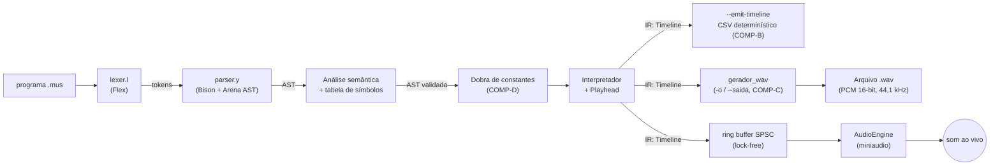

# Visão do Produto e Arquitetura

O Compilador Musical (Grupo 03) é um **compilador em lote (*batch*)** para uma *Domain-Specific Language* (DSL) musical. A organização no GitHub se chama `Interpretador-Musical` por um nome do início do semestre, anterior à formalização do modelo batch ([ADR 001]({{ site.baseurl }})).

A arquitetura separa estritamente quatro responsabilidades distintas do guia de projeto de um compilador:

1. **Compilação** (análise léxica, sintática com AST em arena, semântica e dobra de constantes);
2. **Representação Intermediária (IR)** (`Timeline` de `SoundEvent`s, inspecionável via `--emit-timeline`);
3. **Geração de saída-alvo final** (arquivo WAV PCM 16-bit offline via `-o` / `--saida`);
4. **Execução sonora ao vivo** (fila SPSC *lock-free* consumida pelo motor de áudio *real-time*).



---

## 1. Fases de compilação, IR e saída final

O núcleo do compilador, escrito em **C++17** com **Flex** e **Bison**, não emite som nem interpreta instruções enquanto a música toca. Todo programa `.mus` é analisado e compilado integralmente antes da geração do arquivo final ou da reprodução:

1. **Leitura:** o compilador lê o código-fonte completo do arquivo `.mus` em memória.
2. **Análise léxica** (`lexer/lexer.l`, `src/frontend/`): o Flex quebra o texto em tokens — comandos, notas, números, strings, operadores e pontuação —, registrando linha e coluna (`YY_USER_ACTION`). Figuras rítmicas (`semibreve` a `semifusa`) e `vez` são expandidas como açúcar sintático já no lexer (`CMP-11`, #59). A flag `--tokens` imprime essa tabela sem invocar as fases seguintes.
3. **Análise sintática e AST** (`parser/parser.y`, `src/interpreter/ast.h`, `src/interpreter/arena.{h,cpp}`): o Bison valida a gramática LALR(1) sem conflitos (`%expect 0`, formalizada em [Gramática EBNF]({{ site.baseurl }})) e constrói a **Árvore Sintática Abstrata** (AST). Todos os nós e vetores da AST são alocados em blocos contíguos por uma **Arena de memória** (`Arena`, `MAT-10`, #55) vinculada a `ast::Arvore`, garantindo liberação em bloco sem vazamentos mesmo em erros de sintaxe; além disso, o parser impõe um limite determinístico de **256 níveis de profundidade** (`CMP-08`, #44). Mais detalhes em [Arquitetura da AST]({{ site.baseurl }}).
4. **Análise semântica** (`src/semantic/`): percorre a AST montando a **tabela de símbolos** (nome, tipo, escopo, endereço sequencial e linhas de uso), realiza inferência estática dos quatro tipos (`numero`, `nota`, `booleano`, `string`), valida o isolamento de escopos em blocos `repita` e trilhas paralelas (`CMP-07`, #39) e reporta todos os erros de uma vez com linha e coluna. A flag `--simbolos` imprime a tabela (`CMP-13`, #95).
5. **Otimização da AST** (`src/otimizacao/dobra_constantes.{h,cpp}`): aplica **dobra de constantes** (`COMP-D`, #110) sobre subexpressões cujos operandos são todos constantes, compartilhando as operações exatas de `src/interpreter/operacoes.h` para preservar a `Timeline` bit a bit. Fica ligada por padrão e pode ser desligada com `--sem-otimizacao` para comparação (ver [Otimização]({{ site.baseurl }})).
6. **Geração da Representação Intermediária (IR)** (`src/interpreter/`, `src/core/playhead.h`, `src/core/sound_event.h`): o `Interpretador` percorre a AST otimizada e, com o `Playhead` (soma compensada de Neumaier + âncoras de andamento), produz a **`Timeline`**, uma lista estática de eventos `SoundEvent` governada pelas 6 invariantes formais da `COMP-A` (#104) e protegida por tetos de execução (`5 000 000` eventos e `10 000 000` voltas de `repita`). A IR está especificada em [Representação Intermediária]({{ site.baseurl }}).
7. **Geração da saída-alvo musical** (`src/codegen/gerador_wav.{h,cpp}`): traduz a `Timeline` compilada (e o `SampleBank` já carregado) em um arquivo **WAV PCM 16-bit linear little-endian, mono, 44 100 Hz**, renderizado offline via `-o <arquivo>` ou `--saida <arquivo>` (`COMP-C`, #108). Reutiliza o mesmo renderizador DSP da execução ao vivo sem abrir placa de som, permitindo reproduzir a música em qualquer player sem repetir o parsing do `.mus`. Detalhes completos em [Saída-Alvo Musical (WAV)]({{ site.baseurl }}).

### A instrução da IR: `SoundEvent`

Cada evento agendado na `Timeline` é uma estrutura trivialmente copiável e de *standard layout* definida em `src/core/sound_event.h`:

| Campo | Tipo | Significado |
|---|---|---|
| `startTime` | `double` | Instante de início em segundos |
| `duration` | `double` | Duração em segundos |
| `frequency` | `double` | Altura da nota em Hz (`0.0` em pausas e eventos de sample) |
| `volume` | `float` | Ganho escalar de `0.0` a `1.0` (`0.0` em pausas) |
| `type` | `SoundEventType` | `Synth` (síntese por wavetable) ou `Sample` (áudio WAV, `INT-05`) |
| `sampleId` | `std::uint32_t` | Identificador numérico no `SampleBank` quando `type == Sample` |

### Inspecionando a IR: `--emit-timeline`

A flag `--emit-timeline` executa as fases 1 a 6 e, sem abrir o dispositivo de áudio, imprime a `Timeline` em CSV determinístico no `stdout` (`COMP-B`, #105). Se qualquer fase recusar o programa, nada vai para o `stdout`, os erros vão para `stderr` e o código de saída é `1`.

| Coluna | Conteúdo | Unidade |
|---|---|---|
| `indice` | Posição do evento, a partir de 1 | — |
| `inicio_s` | `startTime` | segundos |
| `duracao_s` | `duration` | segundos |
| `frequencia_hz` | `frequency` | Hz |
| `volume` | `volume` | 0.0 a 1.0 |

* **Ordem:** ordenação estável por `startTime` (eventos simultâneos de trilhas paralelas mantêm a ordem de agendamento).
* **Precisão:** seis casas decimais fixas com ponto separador (locale `"C"`).
* **Pausas:** aparecem com frequência `0.000000` e volume `0.000000`.
* **Restrições:** `--emit-timeline` e `-o`/`--saida` não podem ser combinados com `--tokens` ou `--simbolos`; `-o`/`--saida` também recusa `--demo`, `--loop` e `--test-tone`.

### Exemplo reproduzível de ponta a ponta (`exemplos/arpejo.mus`)

Entrada (`exemplos/arpejo.mus`):

```mus
andamento 120
volume 0.8
tempo = 0.5        // duração em tempos: 0.5 é uma colcheia

repita 4 vezes {
    toca do4  por tempo
    toca mi4  por tempo
    toca sol4 por tempo
}

toca la4 - 2 por tempo * 2
pausa por 1.0
```

1. **Análise léxica (`./build/compilador --tokens exemplos/arpejo.mus`):** extrai `35 tokens` com linha, coluna e valor:
   ```text
     linha  coluna  token           lexema           valor
     -----  ------  --------------  ---------------  -----------------
         6       1  ANDAMENTO       andamento
         6      11  INTEIRO         120              120
         7       1  VOLUME          volume
         7       8  REAL            0.8              0.8
         9       1  IDENT           tempo
         9       7  ATRIBUICAO      =
         9       9  REAL            0.5              0.5
   ...
   35 tokens
   ```
2. **Análise semântica (`./build/compilador --simbolos exemplos/arpejo.mus`):** valida tipos e registra `1` símbolo no escopo global:
   ```text
     endereço  nome             tipo      escopo  declarada  usos (linhas)
     --------  ---------------  --------  ------  ---------  -------------
            0  tempo            numero         0     9:1     12, 13, 14, 19

   1 símbolos
   ```
3. **Representação Intermediária (`./build/compilador -q --emit-timeline exemplos/arpejo.mus`):** desenrola o `repita`, avalia `la4 - 2` (`sol4`, `391.995436 Hz`) e `tempo * 2` (`0.5 s`), emitindo os `14` eventos:
   ```csv
   indice,inicio_s,duracao_s,frequencia_hz,volume
   1,0.000000,0.250000,261.625565,0.800000
   2,0.250000,0.250000,329.627557,0.800000
   3,0.500000,0.250000,391.995436,0.800000
   ...
   13,3.000000,0.500000,391.995436,0.800000
   14,3.500000,0.500000,0.000000,0.000000
   ```
   Rodar com `--sem-otimizacao` produz exatamente o mesmo CSV.
4. **Saída-alvo final (`./build/compilador -o arpejo.wav exemplos/arpejo.mus`):** gera o arquivo WAV reproduzível sem repetir o parsing:
   ```text
   [INFO ] arquivo de entrada: exemplos/arpejo.mus
   [INFO ] 85 samples WAV carregados
   [INFO ] 14 eventos, 4 s de música
   [INFO ] saída WAV gerada: arpejo.wav (176400 frames, 4 s, 352844 bytes)
   ```
   Depois de gerado, `arpejo.wav` pode ser reproduzido diretamente (`aplay arpejo.wav` no Linux, `afplay arpejo.wav` no macOS ou `Media.SoundPlayer` no Windows).

---

## 2. O motor de áudio (execução e síntese DSP)

Tanto a execução ao vivo quanto a renderização offline da `COMP-C` compartilham o mesmo núcleo DSP em `AudioEngine::render` (`src/audio/audio_engine.cpp`), operando a **44 100 Hz, mono**:

* **Síntese por wavetable (`src/audio/wavetable.h`, `DSP-08`, #47):** osciladores de notas `Synth` consultam uma tabela de seno pré-computada (2048 amostras + ponto de guarda, com interpolação linear e fase em `uint32_t`).
* **Reprodução de samples PCM (`src/audio/audio_buffer.h`, `src/audio/sample_bank.h`, `INT-05` / `DSP-06`):** buffers `.wav` da pasta `samples/` são decodificados antes da reprodução e lidos por `SampleId` com interpolação linear no callback.
* **Envelopes adaptativos anti-clique (`DSP-123`):** notas aplicam rampas lineares de ataque e release de até 5 ms (divididas proporcionalmente em notas curtas abaixo de 10 ms).
* **Polifonia e *voice stealing* (`DSP-05`, #30 e `DSP-07`, #42):** pool fixo configurável de até 32 vozes simultâneas; ao exceder o limite, rouba primeiro vozes em *release* ou de menor amplitude (em empate, a mais antiga), aplicando *fade-out* de 2 ms para evitar estalos.
* **Subgrupos, limitador e Volume Master (`DSP-09`, `DSP-10`, `BUG-AUDIO` #109):** ganhos independentes para `Synth` e `Sample`, seguidos no master bus por `LimitadorDePico` (redução de ganho de pico antes de deformar a onda), *soft-clipper* (`softClipBuffer`, limiar `0.8f`) e estágio final de **Volume Master** suavizado linearmente em 5 ms (`GainSmoother`, configurável via `--volume <0..1>`).
* **Consumo ocioso reduzido (`SCH-12`, #66):** no silêncio entre eventos, o callback evita trabalho desnecessário sobre vozes ociosas e laços de espera usam suspensão adequada sem espera ativa (ver [Consumo ocioso]({{ site.baseurl }})).

### A fila entre a timeline e o áudio (`SCH-05`, #29)

Na execução ao vivo, o *ring buffer* (`src/core/ring_buffer.h`) é a única ponte entre a thread principal (produtora) e a thread de áudio da **miniaudio** (consumidora):

* **Carga inteira antes de tocar:** `carregarFila` (`src/core/timeline_queue.h`) garante ordenação estável por início e empurra toda a `Timeline` antes de `AudioEngine::start()`.
* **Capacidade exata e política tudo-ou-nada:** a fila é alocada uma única vez com `timeline.size()`. Se algum evento não couber, o compilador aborta antes de abrir o som.
* **Consumo sem bloqueio (*lock-free*):** `push()` e `pop()` não alocam nem usam mutex (`static_assert` exige `std::atomic<std::size_t>::is_always_lock_free`). A cada frame, o callback dispara todos os eventos vencidos para que acordes comecem no mesmo frame.

| Item | Limite / Parâmetro |
|---|---|
| Memória da fila | `32` bytes por `SoundEvent`, mais 1 slot sentinela |
| Limite de eventos por programa | `5 000 000` eventos (`Interpretador::kMaximoEventos`) |
| Limite de voltas de `repita` | `10 000 000` iterações acumuladas (`Interpretador::kMaximoVoltas`) |
| Polifonia simultânea padrão | Até `32` vozes (`AudioEngine::kMaxVoices`) |

---

## 3. Modelo da linguagem: implementado vs. planejado

Em 16/09/2026 o grupo fixou o modelo de **programa finito** (*batch*), descartando padrões infinitos e *live coding* do TidalCycles (ver [ADR 001]({{ site.baseurl }}) e [Diretrizes de Escopo]({{ site.baseurl }})).

| Capacidade | Situação real no código |
|---|---|
| Variáveis tipadas (`numero`, `nota`, `booleano`, `string`) | **Implementada** (inferência na 1ª atribuição, checagem estática) |
| Comandos musicais (`toca`, `pausa`, `andamento`, `oitava`, `volume`) | **Implementada** (incluindo microtons e samples WAV `"NOME"`) |
| Figuras rítmicas (`semibreve`..`semifusa`) e `vez` | **Implementada** (`CMP-11`, no lexer) |
| Laços `repita N vezes { ... }` com escopo local | **Implementada** |
| Trilhas paralelas finitas `{ a, b }` | **Implementada** (`CMP-07`, [ADR 002]({{ site.baseurl }})) |
| Otimização por dobra de constantes e IR em CSV | **Implementada** (`COMP-D`, `COMP-A`, `COMP-B`) |
| Saída-alvo WAV PCM 16-bit offline (`-o` / `--saida`) | **Implementada** (`COMP-C`) |
| Condicionais (`se`, `entao`, `senao`) e funções (`defina`, `retorna`) | **Planejadas** — tokens reservados no lexer sem regra no `parser.y`; a camada C++ já possui `Ambiente` e `Closure` (`MAT-06`) |

---

## 4. Organização do código

| Pasta | Responsabilidade |
|---|---|
| `lexer/`, `parser/` | Especificações Flex e Bison |
| `src/frontend/` | Invólucro C++ do lexer e do parser (`tokenize`, `parseToAst`) |
| `src/semantic/` | Tabela de símbolos (`TabelaSimbolos`) e análise semântica (`AnalisadorSemantico`) |
| `src/otimizacao/` | Dobra de constantes sobre a AST (`COMP-D`) |
| `src/interpreter/` | AST, alocador em arena (`arena.{h,cpp}`), ambiente/closures e interpretador *tree-walking* |
| `src/core/` | `SoundEvent`, `Timeline`, `Playhead`, emissão CSV, conversão de altura/frames e ring buffer SPSC |
| `src/codegen/` | Gerador da saída-alvo musical em WAV PCM 16-bit offline (`COMP-C`) |
| `src/audio/` | Motor de áudio (`miniaudio`), `wavetable.h`, `limiter.h`, `gain_smoother.h`, `AudioBuffer` e `SampleBank` |
| `src/cli/` | Parsing de opções da linha de comando (`Options`) e logger *thread-safe* |
| `scripts/` | Script de validação de build/release (`validar_release.sh`) |
| `tests/` | Suíte `doctest` e testes de integração/interface CLI executados via CTest e CI |

O lexer e o parser formam a biblioteca `mus_lexer`, separada de `mus_core`, permitindo testar semântica, otimização, IR e matemática temporal sem acoplamento a Flex, Bison ou dispositivo de áudio.

---

## 5. Precisão e validação temporal

O Compilador Musical utiliza `double` para representar instantes e durações na `Timeline`, acumulando a posição musical em *beats* no `Playhead` com soma compensada de Neumaier e conversão via `segundos = beats * (60.0 / BPM)`. Cada instante absoluto é mapeado para frames de áudio pela função única `segundosParaFrame` (`src/core/frames.h`), evitando acúmulo de drift e lacunas entre notas consecutivas — medições detalhadas em [Drift temporal]({{ site.baseurl }}).

### Regras de validação

- O BPM deve ser positivo, finito e numericamente representável.
- Durações musicais não podem ser negativas, `NaN` ou infinitas, nem produzir overflow.
- Valores inválidos são recusados antes de gerar eventos na `Timeline`.
- Mudanças de `andamento` congelam uma âncora temporal e não alteram eventos anteriores.
