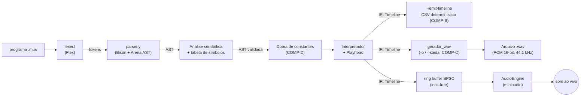

# Visão do Produto e Arquitetura

O Compilador Musical (Grupo 03) é um **compilador em lote (*batch*)** para uma *Domain-Specific Language* (DSL) musical. A organização no GitHub se chama `Interpretador-Musical` por um nome do início do semestre, anterior à formalização do modelo batch ([ADR 001]({{ site.baseurl }})).

A arquitetura se apoia numa separação estrita de responsabilidades — de um lado, o núcleo do compilador (lógica da linguagem e geração de código offline); do outro, o motor de áudio (processamento e síntese do sinal sonoro) — dividindo-se em quatro frentes:

- **Compilação** (análise léxica, análise sintática com AST em arena, análise semântica e dobra de constantes);
- **Representação Intermediária (IR)** (`Timeline` de `SoundEvent`s, inspecionável via `--emit-timeline`);
- **Geração de saída-alvo final** (arquivo WAV PCM 16-bit offline via `-o` / `--saida`);
- **Execução sonora ao vivo** (fila SPSC *lock-free* consumida pelo motor de áudio *real-time*).



---

## 1. O compilador (pré-processamento)

O núcleo do compilador, escrito em **C++17** com **Flex** e **Bison**, não emite som nem executa instruções em tempo real. O processamento é em lote (*batch*): o arquivo `.mus` é lido integralmente em memória e compilado antes da geração do arquivo final ou da reprodução.

A fachada em `src/frontend/frontend.{h,cpp}` (`CMP-12`, #94) e os módulos de análise/otimização orquestram as Fases 1 a 4 antes da Fase 5:

1. **Análise léxica** (`lexer/lexer.l`, `src/frontend/`): o Flex quebra o texto em tokens — comandos, notas, números, strings, operadores e pontuação —, registrando a linha e a coluna de cada um (`YY_USER_ACTION`). Figuras rítmicas (`semibreve` a `semifusa`) e `vez` são expandidas como açúcar sintático já no lexer (`CMP-11`, #59). A flag `--tokens` imprime essa tabela sem invocar as fases seguintes.
2. **Análise sintática e AST** (`parser/parser.y`, `src/interpreter/ast.h`, `src/interpreter/arena.{h,cpp}`): o Bison valida a gramática LALR(1) sem conflitos (`%expect 0`, formalizada em [Gramática EBNF]({{ site.baseurl }})) e constrói a **Árvore Sintática Abstrata** (AST). Todos os nós e vetores da AST são alocados em blocos contíguos por uma **Arena de memória** (`Arena`, `MAT-10`, #55) vinculada a `ast::Arvore`, garantindo liberação em bloco sem vazamentos mesmo em erros de sintaxe; além disso, o parser impõe um limite determinístico de **256 níveis de profundidade** (`CMP-08`, #44). Um erro léxico ou sintático interrompe a compilação com a posição exata, antes de qualquer som. Mais detalhes em [Arquitetura da AST]({{ site.baseurl }}).
3. **Análise semântica** (`src/semantic/`): percorre a AST preenchendo a **tabela de símbolos** (nome, tipo, escopo, endereço sequencial e linhas de uso), realiza inferência estática dos quatro tipos (`numero`, `nota`, `booleano`, `string`), valida o isolamento de escopos em blocos `repita` e trilhas paralelas (`CMP-07`, #39) e recusa uso de nome não declarado ou fora de escopo, troca de tipo numa reatribuição e operações entre tipos incompatíveis, reportando todos os erros de uma vez com linha e coluna. A flag `--simbolos` imprime a tabela (`CMP-13`, #95).
4. **Otimização da AST** (`src/otimizacao/dobra_constantes.{h,cpp}`): aplica **dobra de constantes** (`COMP-D`, #110) sobre subexpressões cujos operandos são todos constantes, compartilhando as operações exatas de `src/interpreter/operacoes.h` para preservar a `Timeline` bit a bit. Fica ligada por padrão e pode ser desligada com `--sem-otimizacao` para comparação (ver [Otimização]({{ site.baseurl }})).
5. **Geração da Representação Intermediária (IR)** (`src/interpreter/`, `src/core/playhead.h`, `src/core/sound_event.h`): o `Interpretador` percorre a AST otimizada e, com o `Playhead` (soma compensada de Neumaier + âncoras de andamento), produz uma **lista estática de eventos musicais temporizados** na memória, a **`Timeline`**, uma sequência de eventos `SoundEvent` governada pelas 6 invariantes formais da `COMP-A` (#104) e protegida por tetos de execução (`5 000 000` eventos e `10 000 000` voltas de `repita`). A IR está especificada em [Representação Intermediária]({{ site.baseurl }}).
6. **Geração da saída-alvo musical** (`src/codegen/gerador_wav.{h,cpp}`): traduz a `Timeline` compilada (e o `SampleBank` já carregado) em um arquivo **WAV PCM 16-bit linear little-endian, mono, 44 100 Hz**, renderizado offline via `-o <arquivo>` ou `--saida <arquivo>` (`COMP-C`, #108). Reutiliza o mesmo renderizador DSP da execução ao vivo sem abrir dispositivo de áudio e sem repetir o parsing do `.mus`. Detalhes completos em [Saída-Alvo Musical (WAV)]({{ site.baseurl }}).

### A instrução da IR: `SoundEvent`

Cada evento agendado na `Timeline` é uma estrutura trivialmente copiável e de *standard layout* definida em `src/core/sound_event.h`:

| Campo | Tipo | Significado |
|---|---|---|
| `startTime` | `double` | Instante de início em segundos |
| `duration` | `double` | Duração em segundos |
| `frequency` | `double` | Altura da nota em Hz (`0.0` em pausas e eventos de sample) |
| `volume` | `float` | Ganho escalar de `0.0` a `1.0` (`0.0` em pausas) |
| `type` | `SoundEventType` | `Synth` (síntese por wavetable) ou `Sample` (áudio WAV, `INT-05`) |
| `sampleId` | `std::uint32_t` | Identificador numérico no `SampleBank` quando `type == Sample` |

### Inspecionando a timeline: `--emit-timeline`

A flag `--emit-timeline` roda as Fases 1 a 5 e, em vez de tocar ou gerar WAV, imprime a `Timeline` em CSV na saída padrão (`COMP-B`, #105). Não abre o dispositivo de áudio, então funciona em máquina sem placa de som e em CI. Se qualquer fase recusar o programa (erro léxico, sintático, semântico ou de execução), nada é impresso na saída padrão, as mensagens de erro vão para a saída de erro e o código de saída é `1`.

```bash
./build/compilador -q --emit-timeline exemplos/arpejo.mus
```

O formato é um contrato, para que a mesma entrada produza sempre a mesma saída, em qualquer sistema:

| Coluna | Conteúdo | Unidade |
|---|---|---|
| `indice` | posição do evento, a partir de 1 | — |
| `inicio_s` | `startTime` | segundos |
| `duracao_s` | `duration` | segundos |
| `frequencia_hz` | `frequency` | Hz |
| `volume` | `volume` | 0.0 a 1.0 |

* **Ordem:** pelo instante de início. Eventos que começam no mesmo instante mantêm a ordem em que o programa os agendou (ordenação estável). É a mesma ordem em que os eventos são entregues ao motor de áudio.
* **Precisão:** seis casas decimais fixas em todas as colunas (`%.6f`, microssegundos nos tempos), sempre com ponto como separador decimal (locale `"C"`).
* **Pausas:** uma `pausa` aparece como um evento silencioso, com frequência `0.000000` e volume `0.000000`, ocupando o tempo da pausa (como a linha 14 do exemplo abaixo).
* **Linhas:** a primeira é o cabeçalho; toda linha termina em `\n`. Um programa sem notas imprime só o cabeçalho.

`--emit-timeline` e `-o`/`--saida` não podem ser combinados com `--tokens` nem com `--simbolos`, para não misturar dois formatos na mesma saída (`-o`/`--saida` também recusa `--demo`, `--loop` e `--test-tone`). A saída esperada de `exemplos/escala.mus` e `exemplos/arpejo.mus` está versionada em `tests/emit_timeline/` e é comparada byte a byte pelo CTest. As invariantes e as regras de tradução da AST para a timeline estão em [Representação Intermediária]({{ site.baseurl }}).

### Gerando a saída-alvo musical: `-o` / `--saida`

As flags `-o <arquivo>` e `--saida <arquivo>` executam a Fase 6 — a etapa explícita de geração de código final (`COMP-C`, #108): traduzem a `Timeline` compilada para um arquivo **WAV PCM 16-bit (44 100 Hz, mono)** renderizado offline, sem abrir dispositivo de áudio e sem repetir a análise léxica/sintática quando reproduzido em players externos.

Os detalhes de escolha do formato, layout do cabeçalho RIFF/WAVE, mapeamento das propriedades musicais e validação estão em [Saída-Alvo Musical (WAV)]({{ site.baseurl }}).

### Exemplo reproduzível de ponta a ponta (`exemplos/arpejo.mus`)

#### 1. Entrada (`exemplos/arpejo.mus`)

```mus
// Arpejo de Dó maior — quatro compassos.
//
// O playhead avança a cada nota, então o mesmo trecho repetido quatro vezes
// vira quatro compassos de música, e não quatro notas simultâneas.

andamento 120
volume 0.8

tempo = 0.5        // duração em tempos: 0.5 é uma colcheia

repita 4 vezes {
    toca do4  por tempo
    toca mi4  por tempo
    toca sol4 por tempo
}

/* Fecha na nota sol4, com o dobro da duração.
   A altura é uma expressão: lá 4 menos 2 semitons dá sol 4. */
toca la4 - 2 por tempo * 2

pausa por 1.0
```

#### 2. Saída léxica — Fase 1 (`--tokens`)

```bash
./build/compilador --tokens exemplos/arpejo.mus
```

Extrai `35 tokens` com linha, coluna e valor correspondentes às linhas acima:

```text
  linha  coluna  token           lexema           valor
  -----  ------  --------------  ---------------  -----------------
      6       1  ANDAMENTO       andamento
      6      11  INTEIRO         120              120
      7       1  VOLUME          volume
      7       8  REAL            0.8              0.8
      9       1  IDENT           tempo
      9       7  ATRIBUICAO      =
      9       9  REAL            0.5              0.5
     11       1  REPITA          repita
     11       8  INTEIRO         4                4
     11      10  VEZES           vezes
...
     21      11  REAL            1.0              1

35 tokens
```

#### 3. Tabela de símbolos — Fase 3 (`--simbolos`)

```bash
./build/compilador --simbolos exemplos/arpejo.mus
```

Valida os tipos após a construção da AST (Fase 2) e registra `1` símbolo no escopo global:

```text
  endereço  nome             tipo      escopo  declarada  usos (linhas)
  --------  ---------------  --------  ------  ---------  -------------
         0  tempo            numero         0     9:1     12, 13, 14, 19

1 símbolos
```

#### 4. Representação Intermediária — Fase 5 (`--emit-timeline`)

```bash
./build/compilador -q --emit-timeline exemplos/arpejo.mus
```

Desenrola o `repita`, avalia `la4 - 2` (`sol4`, `391.995436 Hz`) e `tempo * 2` (`0.5 s`), emitindo os `14` eventos:

```csv
indice,inicio_s,duracao_s,frequencia_hz,volume
1,0.000000,0.250000,261.625565,0.800000
2,0.250000,0.250000,329.627557,0.800000
3,0.500000,0.250000,391.995436,0.800000
...
13,3.000000,0.500000,391.995436,0.800000
14,3.500000,0.500000,0.000000,0.000000
```

Rodar com `--sem-otimizacao` (desligando a Fase 4, dobra de constantes da `COMP-D`) produz exatamente o mesmo CSV.

#### 5. Saída-alvo WAV PCM 16-bit — Fase 6 (`-o` / `--saida`)

```bash
./build/compilador -o arpejo.wav exemplos/arpejo.mus
```

```text
[INFO ] arquivo de entrada: exemplos/arpejo.mus
[INFO ] 85 samples WAV carregados
[INFO ] 14 eventos, 4 s de música
[INFO ] saída WAV gerada: arpejo.wav (176400 frames, 4 s, 352844 bytes)
```

Depois de gerado, `arpejo.wav` pode ser reproduzido diretamente (`aplay arpejo.wav` no Linux, `afplay arpejo.wav` no macOS ou `Media.SoundPlayer` no Windows) sem repetir o parsing.

---

## 2. O motor de áudio (execução)

Só depois da compilação completa, sem nenhum erro, a lista de eventos é entregue ao motor de áudio. Na execução ao vivo, os eventos são ordenados pelo instante de início e colocados num *ring buffer* SPSC (um produtor, um consumidor) sem trava, de onde o callback de áudio da **miniaudio** os consome e sintetiza as frequências, amostra por amostra.

A *miniaudio* é quem conversa com a interface de áudio do sistema operacional (ALSA/PulseAudio no Linux e WSL, CoreAudio no macOS). Com isso, o núcleo do compilador cuida só da estrutura da linguagem e deixa a complexidade do processamento de sinal para o motor de áudio — e pode ser testado sem placa de som, com a flag `--no-audio` (ou compilado para WAV com `-o`/`--saida`).

Tanto a execução ao vivo quanto a renderização offline da `COMP-C` compartilham o mesmo núcleo DSP em `AudioEngine::render` (`src/audio/audio_engine.cpp`), operando a **44 100 Hz, mono**:

* **Síntese por wavetable (`src/audio/wavetable.h`, `DSP-08`, #47):** osciladores de notas `Synth` consultam uma tabela de seno pré-computada (2048 amostras + ponto de guarda, com interpolação linear e fase em `uint32_t`).
* **Reprodução de samples PCM (`src/audio/audio_buffer.h`, `src/audio/sample_bank.h`, `INT-05` / `DSP-06`):** buffers `.wav` da pasta `samples/` são decodificados antes da reprodução e lidos por `SampleId` com interpolação linear no callback.
* **Envelopes adaptativos anti-clique (#123):** notas aplicam rampas lineares de ataque e release de até 5 ms (divididas proporcionalmente em notas curtas abaixo de 10 ms).
* **Polifonia e *voice stealing* (`DSP-05`, #30 e `DSP-07`, #42):** pool fixo configurável de até 32 vozes simultâneas (`AudioEngine::kMaxVoices`); ao exceder o limite, rouba primeiro vozes em *release* ou de menor amplitude (em empate, a mais antiga), aplicando *fade-out* de 2 ms para evitar estalos.
* **Subgrupos, limitador e Volume Master (`DSP-09`, `DSP-10`, `BUG-AUDIO` #109):** ganhos independentes para `Synth` e `Sample`, seguidos no master bus por `LimitadorDePico` (redução de ganho de pico antes de deformar a onda), *soft-clipper* (`softClipBuffer`, limiar `0.8f`) e estágio final de **Volume Master** suavizado linearmente em 5 ms (`GainSmoother`, configurável via `--volume <0..1>`).
* **Consumo ocioso reduzido (`SCH-12`, #66):** no silêncio entre eventos, o callback evita trabalho desnecessário sobre vozes ociosas e laços de espera usam suspensão adequada sem espera ativa (ver [Consumo ocioso]({{ site.baseurl }})).

### A fila entre a timeline e o áudio

O *ring buffer* (`src/core/ring_buffer.h`) é a única ponte entre a thread principal, que produz os eventos, e a thread de áudio, que os consome. As regras de uso (`SCH-05`, #29):

* **Carga inteira antes de tocar.** `carregarFila` (`src/core/timeline_queue.h`) garante a ordenação da timeline por início (com ordenação estável) e empurra todos os eventos antes de `AudioEngine::start()`. Durante a reprodução, nada mais entra na fila.
* **Capacidade exata.** A fila é criada com capacidade igual ao número de eventos da timeline, alocada uma única vez, antes da thread de áudio existir. Por isso, no modelo batch, ela não enche em uso normal.
* **Política de capacidade ultrapassada.** Se, mesmo assim, algum evento não couber, a carga falha e o compilador **não toca nada**: sai com erro `a fila de áudio não comporta os N eventos da timeline`. Uma timeline maior que a fila é recusada antes de qualquer evento entrar (tudo ou nada). Tocar só o que coube perderia notas sem aviso. No uso direto da fila, `push()` devolve `false` quando ela está cheia, então uma recusa sempre é visível para quem empurra.
* **Consumo sem bloqueio.** `push()` e `pop()` não alocam nem usam mutex. Os índices são atômicos, e um `static_assert` exige que `std::atomic<std::size_t>` seja *lock-free* na plataforma, para que nenhum mutex escondido trave a thread de áudio. O callback guarda no máximo um evento "pendente" e, a cada frame, dispara **todos** os eventos que já venceram antes de passar à próxima amostra. Assim uma rajada de eventos simultâneos começa no mesmo frame, em vez de se espalhar por vários.
* **Um produtor, um consumidor.** Só a thread principal chama `push()`, e só o callback chama `pop()`. Duas threads empurrando ao mesmo tempo seria uma corrida de dados.

Limites operacionais:

| Item | Limite |
|---|---|
| Memória da fila | `40` bytes por evento (`sizeof(SoundEvent)`), mais um slot de folga: 10 mil eventos ocupam cerca de 400 KB |
| Eventos na fila | o tamanho da timeline; não há teto na fila além da memória disponível (a interpretação impõe teto de `5 000 000` eventos em `Interpretador::kMaximoEventos` e `10 000 000` voltas em `Interpretador::kMaximoVoltas`) |
| Eventos disparados por frame | todos os vencidos, sem limite |
| Notas soando ao mesmo tempo | Limite configurável no motor (padrão de `32` osciladores em `AudioEngine::kMaxVoices`). Ao exceder a capacidade, a engine aplica algoritmo de *voice stealing* seguro priorizando osciladores em release ou de menor amplitude com *fade-out* rápido anti-clique (`DSP-07`, #42). |

Esses comportamentos são verificados em `tests/test_ring_buffer.cpp` e `tests/test_timeline_queue.cpp`:
- FIFO, fila vazia e cheia, e capacidade zero;
- mil eventos simultâneos e milhares de voltas do índice;
- produtor e consumidor concorrentes com fila de 4 posições, sob ThreadSanitizer no CI;
- a política de carga;
- o callback disparando uma rajada de 40 eventos no mesmo frame;
- uma reprodução inteira esvaziando a fila com a saída limitada a `[-1, 1]`.

---

## 3. Modelo da linguagem: programa finito (implementado vs. planejado)

Em 16/09 o grupo fixou o modelo da linguagem: um programa é uma **música com começo e fim** (como na linguagem Alda). O interpretador percorre a AST uma única vez, monta a timeline inteira e a entrega pronta ao áudio ou à saída WAV.

O modelo descartado foi o do TidalCycles, em que um padrão é uma função infinita do tempo, consultada em pequenas janelas enquanto a música já toca, com *live coding* por cima. Parte das issues do [cronograma]({{ site.baseurl }}) ainda descreve esse modelo; elas deixaram de ser o caminho crítico do projeto. O contexto, as alternativas e o efeito sobre cada issue estão no [ADR 001: Modelo Batch]({{ site.baseurl }}) e em [Diretrizes de Escopo]({{ site.baseurl }}).

| Capacidade | Situação real no código |
|---|---|
| Variáveis tipadas (`numero`, `nota`, `booleano`, `string`) | **Implementada** (inferência na 1ª atribuição, checagem estática) |
| Comandos musicais (`toca`, `pausa`, `andamento`, `oitava`, `volume`) | **Implementada** (incluindo microtons e samples WAV `"NOME"`) |
| Figuras rítmicas (`semibreve`..`semifusa`) e `vez` | **Implementada** (`CMP-11`, no lexer) |
| Laços `repita N vezes { ... }` com escopo local | **Implementada** |
| Trilhas paralelas finitas `{ a, b }` | **Implementada** (`CMP-07`, [ADR 002]({{ site.baseurl }})) |
| Otimização por dobra de constantes e IR em CSV | **Implementada** (`COMP-D`, `COMP-A`, `COMP-B`) |
| Saída-alvo WAV PCM 16-bit offline (`-o` / `--saida`) | **Implementada** (`COMP-C`) |
| Condicionais (`se`, `entao`, `senao`) e funções (`defina`, `retorna`) | **Planejadas** — tokens reservados no lexer sem regra no `parser.y`; a camada C++ já possui `Ambiente` e `Closure` (`MAT-06`) |

---

## 4. Organização do código

| Pasta | Responsabilidade |
|---|---|
| `lexer/`, `parser/` | Especificações Flex e Bison |
| `src/frontend/` | Invólucro C++ do lexer e do parser (`tokenize`, `parseToAst`) |
| `src/semantic/` | Tabela de símbolos (`TabelaSimbolos`) e análise semântica (`AnalisadorSemantico`) |
| `src/otimizacao/` | Dobra de constantes sobre a AST (`COMP-D`) |
| `src/interpreter/` | AST, alocador em arena (`arena.{h,cpp}`), ambiente/closures e interpretador *tree-walking* |
| `src/core/` | `SoundEvent`, `Timeline`, `Playhead`, emissão CSV, conversão de altura/frames e ring buffer SPSC |
| `src/codegen/` | Gerador da saída-alvo musical em WAV PCM 16-bit offline (`COMP-C`) |
| `src/audio/` | Motor de áudio (`miniaudio`), `wavetable.h`, `limiter.h`, `gain_smoother.h`, `AudioBuffer` e `SampleBank` |
| `src/cli/` | Parsing de opções da linha de comando (`Options`) e logger *thread-safe* |
| `scripts/` | Script de validação de build/release (`validar_release.sh`) |
| `tests/` | Suíte `doctest` e testes de integração/interface CLI executados via CTest e CI |

O lexer e o parser formam uma biblioteca própria (`mus_lexer`), separada da biblioteca do núcleo (`mus_core`). Isso permite testar cada parte sem o executável e sem depender de Flex e Bison onde eles não são necessários.

---

## 5. Precisão e validação temporal

O Compilador Musical utiliza valores `double` para representar
instantes e durações dos eventos musicais.

O `Playhead` acumula a posição musical em *beats* (com soma compensada de Neumaier) e realiza
a conversão para segundos utilizando:

```text
segundos = beats * (60.0 / BPM)
```

Essa estratégia evita acumular diretamente os erros de
arredondamento de cada duração em segundos. Cada instante absoluto é mapeado para frames de áudio pela função única `segundosParaFrame` (`src/core/frames.h`), evitando lacunas entre notas consecutivas.

### Regras de validação

- O BPM deve ser positivo, finito e numericamente representável.
- Durações musicais não podem ser negativas.
- Durações `NaN` ou infinitas são rejeitadas.
- Avanços que produziriam overflow são rejeitados.
- Valores inválidos não devem gerar eventos na timeline.
- Uma mudança de BPM não altera os instantes anteriores (congelando uma âncora temporal).

#### Precisão dos testes

Os testes utilizam `doctest::Approx` para comparar valores
de ponto flutuante que não possuem representação binária exata.

A tolerância de comparação deve ser escolhida conforme a escala
e a finalidade de cada teste, sem mascarar erros temporais.

Testes específicos verificam:

- Conversões entre beats e segundos.
- Alterações de andamento.
- Durações fracionárias.
- Pausas e repetições.
- Rejeição de valores inválidos.
- Preservação da posição temporal.

#### Limitações

Esta validação garante representabilidade e consistência
dos cálculos temporais do compilador.

Ela não garante, isoladamente, precisão de reprodução em
frames de áudio nem ausência de drift durante a renderização.
Essas verificações são tratadas separadamente na MAT-08 (#45) — ver
[Drift temporal]({{ site.baseurl }}).
