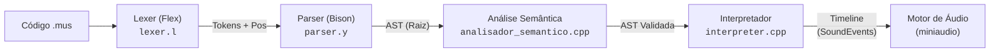
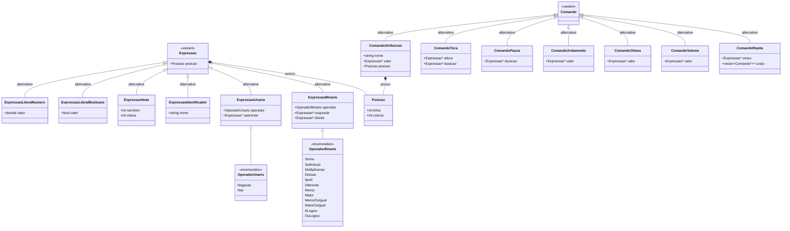
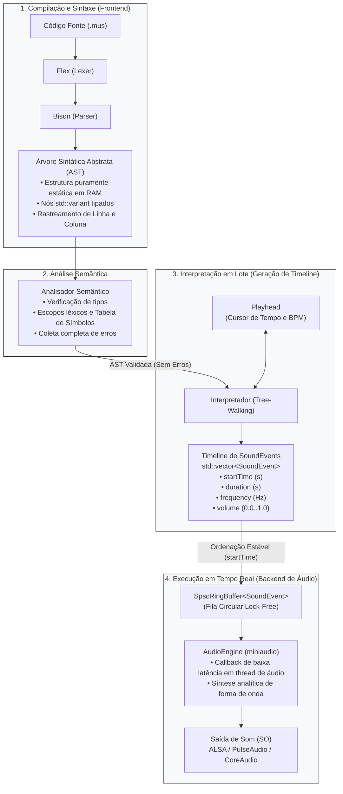

# Arquitetura e Decisões de Design da AST

A **Árvore Sintática Abstrata** (*Abstract Syntax Tree* — AST) é a estrutura de dados central do compilador da nossa linguagem musical (Grupo 03 — Compiladores 1, FGA/UnB). Ela representa a estrutura gramatical e semântica do programa em memória, expurgando ruídos sintáticos concretos (chaves, palavras-chave auxiliares, parênteses) e preservando a hierarquia das instruções para as etapas subsequentes.

Este documento formaliza as decisões arquiteturais, o catálogo de nós, os mecanismos de rastreamento posicional e a separação estrita de responsabilidades entre o processamento da árvore e a síntese de som.

---

## 1. O Papel da AST no Pipeline do Compilador

O nosso compilador opera em modo **lote (*batch*)**: o código-fonte `.mus` é lido, validado e interpretado integralmente antes que qualquer áudio seja sintetizado. A AST atua como a fronteira entre o *frontend* léxico/sintático e o *backend* semântico e interpretativo.



1. **Construção (`parser/parser.y`):** Durante o parsing LALR(1), as ações semânticas instanciam os nós da árvore a partir das reduções gramaticais.
2. **Validação e Tipagem (`src/semantic/`):** A análise semântica caminha pelos nós da AST conferindo escopo, resolvendo identificadores na tabela de símbolos e validando a compatibilidade de tipos em expressões e comandos.
3. **Interpretação e Geração de Eventos (`src/interpreter/`):** O interpretador percorre a AST validada (*tree-walking*) e, com o auxílio do cursor temporal (`Playhead`), converte as instruções em uma lista estática de eventos temporizados (`Timeline` de `SoundEvent`).
4. **Isolamento de Áudio:** A AST é **estritamente estática e sintática**. Nenhum nó emite som, toca instrumentos ou interage com threads de áudio.

---

## 2. Decisões de Engenharia de Software

### C++17 `std::variant` vs. Hierarquia Clássica Orientada a Objetos

Em implementações clássicas de compiladores em C++, a AST costuma ser modelada como uma hierarquia de classes com uma classe base abstrata e métodos virtuais (`virtual void accept(Visitor* v) = 0`), exigindo o padrão *GoF Visitor*.

No nosso projeto, optamos deliberadamente por **Tipos de Dados Algébricos (ADT / *Sum Types*)** utilizando recursos modernos do **C++17**: `std::variant`, composições de estruturas simples e *pattern matching* estático via `std::visit`.

As justificativas técnicas para essa decisão de design são:

#### a) Eliminação de Sobrecarga de Polimorfismo Dinâmico (Zero-Overhead)
* Classes com métodos virtuais injetam um ponteiro para a tabela virtual (`vptr` / `vtable`) em cada instância. Em arquiteturas de 64-bit, isso adiciona **8 bytes de *overhead* por nó**.
* A invocação virtual gera chamadas indiretas com salto na tabela de despacho, inibindo *inlining* e prejudicando a localidade de cache (*instruction cache*).
* Nós baseados em `struct` plana e `std::variant` possuem *layout* de memória compacto e previsível, alinhados com o princípio de custo zero de abstração do C++.

#### b) Pattern Matching Estático e Coesão Funcional
* Com `std::visit` e *lambdas* polimórficos (`if constexpr (std::is_same_v<T, ...>)`), as operações sobre a árvore (como `analisarComando`, `tipoDe`, `executarComando`, `avaliarExpressao`) ficam concentradas em seus respectivos módulos lógicos (`analisador_semantico.cpp`, `interpreter.cpp`).
* Isso evita a dispersão de lógica que ocorre quando novos comportamentos precisam ser implementados em dezenas de arquivos de classes individuais ou quando se cria a prolixidade do padrão *Visitor* clássico.

#### c) Garantia de Exaustividade em Tempo de Compilação
O compilador C++ assegura que nenhum nó fique sem tratamento. No nosso código, o uso de `static_assert` dentro do último ramo do *visitor* garante que qualquer novo nó adicionado a `ast::Comando` ou `ast::Expressao` quebre a compilação imediatamente caso não seja implementado:

```cpp
// Exemplo real de src/interpreter/interpreter.cpp e analisador_semantico.cpp
static_assert(std::is_same_v<T, ast::ComandoRepita>,
              "novo alternative em ast::Comando sem visitor aqui");
```

#### d) Compatibilidade com Flex e Bison em Múltiplas Plataformas
* Ferramentas clássicas como o Bison utilizam `%union` para os tipos de retorno semânticos das regras.
* O Bison moderno suporta `%define api.value.type variant`, porém ele exige exclusivamente skeletons C++ (`lalr1.cc`) e versões recentes do Bison (3.x+).
* No ambiente do projeto (Linux, Windows via WSL e macOS), versões mais antigas do Bison (como a 2.3 fornecida historicamente pela Apple no macOS) são encontradas. O `%union` contendo ponteiros simples (`mus::ast::Expressao*`, `mus::ast::Comando*`) permitiu compilação limpa e portátil de ponta a ponta sem recorrer a macros incompatíveis.

#### e) Gerenciamento de Vida Útil e Desempenho em Compilação *Batch*
Como o ciclo de execução do compilador termina logo após a geração da `Timeline`, a AST tem vida efêmera e delimitada ao processo. Nós simples são instanciados diretamente via `new` durante as reduções gramaticais. Essa abordagem mantém a AST enxuta para os requisitos da disciplina, deixando a introdução de ponteiros inteligentes (`std::unique_ptr`) reservada para fases futuras que demandem aninhamento arbitrário de nós filhos profundos (como estruturas condicionais complexas na CMP-04).

---

## 3. Catálogo e Estruturas dos Nós (`src/interpreter/ast.h`)

Todos os nós e enums residem sob o *namespace* `mus::ast`.



### 3.1. Estruturas Auxiliares e Enums

#### `Posicao`
Guarda as coordenadas de origem no arquivo `.mus`:
```cpp
struct Posicao {
    int linha = 0;
    int coluna = 0;
};
```
* A convenção adota indexação **1-based** (linha e coluna iniciam em 1), compatível com o `Token` emitido pelo lexer.
* O valor `0` indica "sem posição" (nó sintético criado programaticamente, por exemplo, em testes unitários).

#### `OperadorBinario` e `OperadorUnario`
* **`OperadorBinario`:** `Soma`, `Subtracao`, `Multiplicacao`, `Divisao`, `Igual`, `Diferente`, `Menor`, `Maior`, `MenorOuIgual`, `MaiorOuIgual`, `ELogico`, `OuLogico`.
  * *Nota de Design:* Os operadores lógicos são denominados `ELogico` e `OuLogico` (em vez de `E` e `Ou`) para evitar colisão com o token `E` gerado pelo Bison. Em versões legadas como o Bison 2.3, os códigos de token são emitidos como macros `#define E <código>`, o que quebraria a compilação do C++ caso o enum usasse o identificador `E`.
* **`OperadorUnario`:** `Negacao` (menos aritmético unário, `-x`) e `Nao` (negação lógica, `nao x`).

---

### 3.2. As Expressões (`struct Expressao`)

Uma expressão é uma variante fechada entre os tipos de valores que produzem resultado avaliável:

```cpp
struct Expressao : std::variant<ExpressaoLiteralNumero, ExpressaoLiteralBooleano,
                                 ExpressaoNota, ExpressaoIdentificador,
                                 ExpressaoUnaria, ExpressaoBinaria> {
    using variant::variant;
    Posicao posicao;
};
```

| Tipo de Nó | Campos | Descrição Semântica / Decisão de Projeto |
|---|---|---|
| `ExpressaoLiteralNumero` | `double valor` | Unifica números inteiros e de ponto flutuante em `double` em tempo de execução, simplificando o cálculo de durações e andamentos sem perda de precisão. |
| `ExpressaoLiteralBooleano` | `bool valor` | Representa os literais booleanos nativos (`verdadeiro` e `falso`). |
| `ExpressaoNota` | `int semitom`<br/>`int oitava` | **Decisão Fundamental de Design:** Quando o programa escreve `toca do por tempo` (sem oitava explícita), o campo `oitava` recebe o valor centinela `-1`. A resolução para a altura MIDI **não é feita no parser**; ela ocorre dinamicamente no interpretador, consultando a oitava corrente. Isso é crucial porque um laço `repita` pode conter um comando de alteração de `oitava` que deve impactar as notas subsequentes a cada iteração. |
| `ExpressaoIdentificador` | `std::string nome` | Referência nominal a uma variável (ex: `tempo`). |
| `ExpressaoUnaria` | `OperadorUnario operador`<br/>`Expressao* operando` | Aplicação de `-` ou `nao` a uma subexpressão. |
| `ExpressaoBinaria` | `OperadorBinario operador`<br/>`Expressao* esquerda`<br/>`Expressao* direita` | Operações aritméticas, relacionais e lógicas. Permite cálculos musicais dinâmicos, como transposição (`la4 - 2`) e intervalos (`sol4 - do4`). |

---

### 3.3. Os Comandos (`struct Comando`)

Um comando representa uma instrução de ação imperativa ou de controle de fluxo na linguagem:

```cpp
struct Comando : std::variant<ComandoAtribuicao, ComandoToca, ComandoPausa,
                               ComandoAndamento, ComandoOitava, ComandoVolume,
                               ComandoRepita> {
    using variant::variant;
};
```

| Tipo de Nó | Campos | Responsabilidade e Semântica |
|---|---|---|
| `ComandoAtribuicao` | `std::string nome`<br/>`Expressao* valor`<br/>`Posicao posicao` | Atribuição de valor a uma variável (`nome = valor`). Armazena a posição exata do identificador para checagens de escopo e tipagem na análise semântica. |
| `ComandoToca` | `Expressao* altura`<br/>`Expressao* duracao` | Instrução central da linguagem (`toca <altura> por <duracao>`). Aceita notas (`Tipo::Nota`) ou números MIDI brutos (`Tipo::Numero`) e durações em tempos. |
| `ComandoPausa` | `Expressao* duracao` | Instrução de silêncio (`pausa por <duracao>`). No interpretador, gera um `SoundEvent` com frequência e volume nulos, avançando o cursor temporal. |
| `ComandoAndamento` | `Expressao* valor` | Modifica a velocidade da peça em batidas por minuto (`andamento <bpm>`). Requer expressão numérica positiva. |
| `ComandoOitava` | `Expressao* valor` | Altera a oitava padrão corrente utilizada pelas notas que não especificam oitava explícita (`oitava <n>`). |
| `ComandoVolume` | `Expressao* valor` | Ajusta o ganho/amplitude global da reprodução (`volume <v>`), tipicamente no intervalo [0.0, 1.0]. |
| `ComandoRepita` | `Expressao* vezes`<br/>`std::vector<Comando*>* corpo` | Estrutura de repetição finita (`repita N vezes { ... }`). Abre e fecha um escopo léxico na análise semântica e reexecuta as instruções do bloco em tempo de execução. |

---

## 4. O Sistema de Rastreamento de Posição (`linha` e `coluna`)

A integridade das mensagens de erro do compilador depende da capacidade de apontar o local exato onde uma inconformidade ocorreu. A AST não descarta a geometria do texto original; ela armazena as coordenadas precisas repassadas pelo analisador léxico.

### 4.1. Fluxo de Propagação da Posição

```mermaid
sequenceDiagram
    autonumber
    actor Dev as Usuário
    participant L as Lexer (Flex)
    participant P as Parser (Bison)
    participant A as AST (ast.h)
    participant S as Semântica (analisador_semantico)

    Dev->>L: Fornece código .mus
    Note over L: YY_USER_ACTION atualiza<br/>tokenAtual.linha/coluna e yylloc
    L->>P: Emite terminal + yylval/yylloc
    Note over P: Regras gramaticais constroem nós<br/>via novaExpressao / binaria / unaria
    P->>A: Carimba Posicao{linha, coluna} nos nós
    P->>S: Entrega AST raiz (std::vector<Comando*>*)
    Note over S: Valida tipos e escopos;<br/>se houver erro, usa nó->posicao
    S->>Dev: Emite erro: "Linha X, Coluna Y: mensagem"
```

1. **Captura no Lexer (`lexer/lexer.l`):**
   * A macro `YY_USER_ACTION` é executada antes de cada ação de casamento de padrão, invocando `mus::scanner::avancarPosicao(yytext, yyleng)` e preenchendo as variáveis de localização do Bison (`yylloc.first_line` e `yylloc.first_column`).
   * Para os terminais que possuem valor semântico (como `IDENT`, `NOTA`, literais), a função auxiliar `novaExpressao()` instancia o nó já carimbando a sua `Posicao`.

2. **Propagação nas Regras Gramaticais (`parser/parser.y`):**
   * **Nós Folhas:** A posição é a do próprio token extraído pelo lexer.
   * **Expressões Binárias:** A expressão herda a posição do operando da esquerda (`no->posicao = esquerda->posicao`). Por exemplo, em `la4 - 2`, a expressão binária começa no caractere inicial de `la4`.
   * **Expressões Unárias:** Em `-do4` ou `nao verdadeiro`, o nó começa no operador (`-` ou `nao`). Como esses operadores são palavras-chave ou símbolos sem valor semântico próprio no `%union`, a sua localização é recuperada via `%locations` do Bison através de `@1.first_line` e `@1.first_column`.
   * **Atribuição:** O comando `ComandoAtribuicao` armazena a posição do identificador (`$1->posicao`) localizado à esquerda do operador de igualdade.

### 4.2. O Papel na Análise Semântica

A análise semântica consome as posições da AST para emitir diagnósticos padronizados idênticos ao formato do analisador sintático (`Linha X, Coluna Y: <mensagem>`):

```cpp
// src/semantic/analisador_semantico.cpp
std::string ErroSemantico::formatado() const {
    return "Linha " + std::to_string(posicao.linha) + ", Coluna " +
           std::to_string(posicao.coluna) + ": " + mensagem;
}
```

Exemplos de erros diagnosticados com precisão posicional da AST:
* **Identificador Indefinido:** Aponta a posição de uso do identificador lido:
  `[ERROR] erro semântico: Linha 14, Coluna 14: 'frase' usado antes de ser declarado ou fora de escopo`
* **Redeclaração com Tipo Inválido:** Aponta a posição da nova atribuição:
  `[ERROR] erro semântico: Linha 17, Coluna 1: redeclaração inválida: 'tempo' é numero, recebeu booleano`
* **Incompatibilidade de Tipos em Operador:** Aponta o início da expressão binária ou unária:
  `[ERROR] erro semântico: Linha 21, Coluna 6: operação inválida: nota + nota`
* **Validação de Argumentos:**
  `[ERROR] erro semântico: Linha 8, Coluna 6: andamento espera numero, recebeu nota`

> **Tratamento Sem Efeito Cascata:** Quando uma expressão resulta em erro, a semântica associa a ela o tipo sentinela `Tipo::Erro`. Isso assegura que múltiplos erros independentes sejam todos reportados de uma só vez para o usuário sem produzir mensagens espúrias derivadas da falha inicial.

---

## 5. Separação Estrita de Responsabilidades: Da AST ao Áudio

Um dos pilares arquiteturais do projeto é o **desacoplamento absoluto entre a representação da linguagem e o mecanismo de síntese de áudio**.

A AST não toca som em tempo real. O compilador musical traduz o programa estaticamente em eventos e apenas entrega esses eventos prontos para o *driver* de áudio:



### Por que essa separação é essencial?

1. **Determinismo e Testabilidade:**
   * O interpretador e a AST podem ser testados de forma 100% determinística através de testes unitários (`test_ast.cpp`, `test_interpreter.cpp`), verificando se os `SoundEvent` gerados têm as frequências, durações e instantes de início exatos.
   * O compilador pode ser executado com a *flag* `--no-audio` em ambientes de Integração Contínua (CI) e servidores *headless* sem falhar por ausência de dispositivo de áudio físico.
2. **Imunidade a *Buffer Underruns* e *Jitter*:**
   * Se a árvore sintática fosse percorrida concorrentemente dentro do *callback* de áudio em tempo real, qualquer alocação de memória, resolução de variáveis ou percurso de árvore causaria bloqueios na thread de alta prioridade, gerando estalos sonoros (*glitches*).
   * Com a estrutura `SoundEvent` sendo **trivialmente copiável** (`std::is_trivially_copyable<SoundEvent>::value == true`), os eventos cruzam a barreira entre a thread principal e a thread de áudio via uma fila sem travas (`SpscRingBuffer`), garantindo segurança estrita de tempo real (*real-time safety*).

---

## 6. Exemplo de Mapeamento: Do Código `.mus` à AST

Considere o seguinte trecho válido da linguagem:

```text
andamento 120
tempo = 0.5
repita 2 vezes {
    toca do4 por tempo
}
```

A árvore sintática construída na memória pelo `parser/parser.y` possui a seguinte estrutura hierárquica:

```text
std::vector<mus::ast::Comando*> (Programa)
│
├── [0] Comando (ComandoAndamento)
│       └── valor: Expressao (ExpressaoLiteralNumero)
│               ├── posicao: {linha: 1, coluna: 11}
│               └── valor: 120.0
│
├── [1] Comando (ComandoAtribuicao)
│       ├── nome: "tempo"
│       ├── posicao: {linha: 2, coluna: 1}
│       └── valor: Expressao (ExpressaoLiteralNumero)
│               ├── posicao: {linha: 2, coluna: 9}
│               └── valor: 0.5
│
└── [2] Comando (ComandoRepita)
        ├── vezes: Expressao (ExpressaoLiteralNumero)
        │       ├── posicao: {linha: 3, coluna: 8}
        │       └── valor: 2.0
        └── corpo: std::vector<mus::ast::Comando*>*
                │
                └── [0] Comando (ComandoToca)
                        ├── altura: Expressao (ExpressaoNota)
                        │       ├── posicao: {linha: 4, coluna: 10}
                        │       ├── semitom: 0  (Dó)
                        │       └── oitava: 4   (Dó Central / MIDI 60)
                        └── duracao: Expressao (ExpressaoIdentificador)
                                ├── posicao: {linha: 4, coluna: 14}
                                └── nome: "tempo"
```

Ao percorrer essa árvore, o `Interpretador`:
1. Atualiza o BPM do `Playhead` para 120 (cada tempo dura $0.5$ segundo).
2. Armazena a variável `tempo = 0.5` na tabela do interpretador.
3. Executa o corpo do laço 2 vezes:
   * **Volta 1:** Lê `do4` (MIDI 60 $\approx$ 261.63 Hz), busca `tempo` ($0.5$ batidas = $0.25$ segundos), insere `SoundEvent{startTime: 0.0s, duration: 0.25s, freq: 261.63Hz}` e avança o cursor temporal do playhead em $0.25$s.
   * **Volta 2:** Lê `do4`, busca `tempo`, insere `SoundEvent{startTime: 0.25s, duration: 0.25s, freq: 261.63Hz}` e avança o cursor para $0.5$s.
4. Gera a `Timeline` final contendo 2 eventos perfeitamente ordenados.

---

## 7. Referências de Implementação no Código-Fonte

Para consultas técnicas adicionais, inspecione diretamente os fontes:
* **Definição da AST:** [`src/interpreter/ast.h`](file:///c:/Users/cecil/Documents/Grupo03-COMP01/src/interpreter/ast.h)
* **Geração da AST no Parser:** [`parser/parser.y`](file:///c:/Users/cecil/Documents/Grupo03-COMP01/parser/parser.y)
* **Consumo e Validação Semântica:** [`src/semantic/analisador_semantico.h`](file:///c:/Users/cecil/Documents/Grupo03-COMP01/src/semantic/analisador_semantico.h) e [`src/semantic/analisador_semantico.cpp`](file:///c:/Users/cecil/Documents/Grupo03-COMP01/src/semantic/analisador_semantico.cpp)
* **Avaliação da AST e Playhead:** [`src/interpreter/interpreter.h`](file:///c:/Users/cecil/Documents/Grupo03-COMP01/src/interpreter/interpreter.h) e [`src/interpreter/interpreter.cpp`](file:///c:/Users/cecil/Documents/Grupo03-COMP01/src/interpreter/interpreter.cpp)
* **Estrutura de Evento de Som:** [`src/core/sound_event.h`](file:///c:/Users/cecil/Documents/Grupo03-COMP01/src/core/sound_event.h)
* **Testes Automatizados da AST:** [`tests/test_ast.cpp`](file:///c:/Users/cecil/Documents/Grupo03-COMP01/tests/test_ast.cpp)
