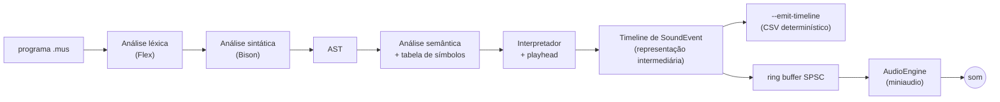

# ADR 001: Compilação batch de programas musicais finitos

| | |
|---|---|
| **Status** | Aceita |
| **Decidida em** | 16/09/2026, pelo grupo |
| **Registrada em** | 01/11/2026, na DOC-B (#107) |
| **Substitui** | o modelo de padrões infinitos com *live coding* do planejamento inicial |

Este é o registro formal de uma decisão que já orienta o código desde a Sprint 2. Até aqui ela aparecia em três lugares soltos: um parágrafo da [Visão de Arquitetura]({{ site.baseurl }}), um aviso no [Cronograma]({{ site.baseurl }}) e os comentários de encerramento de nove issues. Este documento junta tudo, com o porquê, e mapeia o efeito da decisão sobre o backlog.

---

## 1. Contexto

O planejamento das seis sprints, escrito em agosto, descrevia uma linguagem no modelo do **TidalCycles**:

- um **padrão** é uma função infinita do tempo, `Pattern = função(Arc) → [Hap]`, que nunca "termina";
- o motor de áudio **consulta** o padrão em pequenas janelas (*lookahead*) enquanto a música já toca;
- o usuário edita o código **durante** a execução (*live coding*), e a árvore nova substitui a velha sem parar o som (*hot-swap*);
- a sintaxe rítmica é a **mini-notação** do Tidal: `[ ]` para subdividir, `*` para repetir, `{ , }` para polirritmia.

Várias issues foram escritas símbolo por símbolo a partir desse modelo: ciclos de 0.0 a 1.0 (MAT-02), lookahead (SCH-04, SCH-06), troca atômica de AST (MAT-09, SCH-09, SCH-10), parser tolerante a erro para não parar a música (CMP-09), terminal interativo (INT-09, CMP-10) e a própria mini-notação (CMP-05, CMP-07).

Três pontos pesaram contra esse plano:

1. **A disciplina pede um compilador.** O [guia de projeto](https://github.com/sergioaafreitas/COMP1) da disciplina organiza o trabalho em etapas: análise léxica, análise sintática, AST, análise semântica, código intermediário, saída. No modelo Tidal, a "compilação" nunca termina: ela se mistura à execução, e quase todo o esforço vai para a infraestrutura de tempo real (filas sem trava, troca atômica de ponteiros, janelas de consulta), que não é nenhuma dessas etapas.
2. **O modelo não tinha sido escolhido, só herdado.** Nenhuma decisão do grupo dizia que a linguagem precisava de padrões infinitos: as issues trouxeram isso junto com a referência usada no planejamento.
3. **O que já estava pronto apontava para o outro lado.** O `Playhead` e a `Timeline` da Sprint 1 (`play()` agenda e avança, `playHere()` faz acorde, `rest()` pausa) já eram o *runtime* de um programa finito, e testados.

## 2. Alternativas consideradas

### A. Padrões infinitos com live coding (modelo Tidal)

O programa descreve um padrão; o motor consulta o padrão continuamente; o código é recarregado sem parar o som.

- **A favor:** é o modelo mais expressivo para música eletrônica em loop, e era o plano original.
- **Contra:** a semântica de "programa" vira a de "função do tempo", e as etapas clássicas do compilador ficam em segundo plano. Exige a infraestrutura de concorrência mais difícil do projeto (hot-swap seguro, lookahead calibrado) antes de qualquer som. E é difícil de testar de forma determinística: a saída depende de quando a consulta acontece.

### B. Programa finito, compilado inteiro antes de tocar (modelo Alda)

O programa é uma música com começo e fim, como na linguagem [Alda](https://alda.io). O compilador lê o arquivo inteiro, valida, gera a sequência completa de eventos e só então a entrega ao áudio.

- **A favor:** cada etapa do guia tem um lugar claro e um artefato verificável. Erros são detectados antes de qualquer som. A saída é determinística, então pode ser comparada byte a byte em teste. Aproveita o `Playhead` e a `Timeline` já existentes.
- **Contra:** sem *live coding*; não existe música "sem fim" (o `repita` exige uma contagem); a memória cresce com o número de eventos.

Não há registro de uma terceira alternativa.

## 3. Decisão

**O projeto segue o modelo B.** Um programa `.mus` é processado em lote (*batch*):

Toda a análise termina **antes** de o dispositivo de áudio ser aberto: um erro léxico, sintático, semântico ou de execução encerra o programa sem tocar nada. A `Timeline` é a representação intermediária do compilador, especificada em [Representação Intermediária]({{ site.baseurl }}).

## 4. Consequências

### No código

| Componente | Situação |
|---|---|
| `Playhead`, `Timeline`, `SoundEvent` (`src/core/`) | viraram o centro do runtime |
| `Arc` e `Hap` (`src/core/arc.h`, `hap.h`) | **mantidos**. `whole`/`part` e `hasOnset()` são desenho do Tidal e não estão no caminho crítico, mas a subdivisão de `Arc::cycles()` serve à divisão rítmica da MAT-05 (#28) |
| `Pattern` (`src/core/pattern.h`) | mantido como lista de `Hap`; o `Pattern` funcional não foi construído |
| Ring buffer SPSC lock-free (SCH-03) | **mantido**, com papel menor: transporta à thread de áudio eventos **já compilados**, e não consultas a um padrão vivo |
| Lookahead, hot-swap, troca atômica de AST, terminal interativo | **não construídos** |
| Análise semântica e tabela de símbolos (CMP-13) | possível de forma completa, porque o programa inteiro é conhecido antes da execução |
| `--emit-timeline` (COMP-B) | possível porque a saída é determinística; é o que os testes de interface comparam |

### Na linguagem

- `repita N vezes { ... }` exige `N`; não há laço infinito.
- Não existe mini-notação: ritmo se escreve com `toca ... por <duração>`. A sintaxe implementada está na [Especificação de Requisitos]({{ site.baseurl }}), e a gramática formal, na DOC-A (#106).
- Funções e condicionais (`defina`, `se`) continuam compatíveis com o modelo: são avaliadas uma vez, na geração da timeline.

### No processo

- A decisão foi tomada em 16/09, mas as issues só foram revistas em 29/10. Nesse intervalo o cronograma continuou descrevendo o modelo antigo, com um aviso no topo. A seção 5 mapeia o estado de cada issue depois da revisão.
- O cronograma realinhado às novas prioridades está no PR #111 (DOC-B depende dele para o critério "cronograma alinhado").

---

## 5. Matriz do backlog

Estado em 01/11/2026. As classificações das seções 5.4 e 5.5 são **propostas**: mudar o estado de uma issue é decisão do grupo, e esta página só registra a recomendação.

### 5.1 Encerradas por mudança de escopo

Fechadas em 29/10, todas com o comentário "Encerramento por alteração de escopo", que cita a decisão batch.

| Issue | Do modelo descartado |
|---|---|
| SCH-04 (#23) | calibração da janela de lookahead |
| SCH-06 (#35) | propagação de consultas de lookahead pela árvore |
| CMP-09 (#49) | parser que ignora erro para não parar a música |
| MAT-09 (#50) | ponteiros atômicos `AST_Active`/`AST_Next` |
| SCH-09 (#51) | hot-swap no lookahead |
| INT-09 (#53) | terminal interativo em modo raw |
| CMP-10 (#54) | entrada assíncrona no parser |
| SCH-10 (#56) | troca quantizada no fim do ciclo |
| INT-10 (#58) | metrônomo visual sincronizado |

{: .aviso }
> As nove foram fechadas com o motivo **"completed"** do GitHub, e não **"not planned"**. Na contagem do projeto, elas aparecem como entregues. Recomendação: reabrir e fechar de novo com o motivo *not planned*, mantendo o comentário. O histórico não se perde.

### 5.2 Mantidas, reescritas para o escopo batch

O texto foi atualizado em 29/10 para falar de timeline finita em vez de ciclos ou padrões.

| Issue | Foco depois da revisão |
|---|---|
| CMP-04 (#21) | AST completa e íntegra, depois da MAT-11 e da CMP-08 |
| MAT-04 (#22) | precisão numérica da timeline (fechada em 30/10; código integrado pelo PR #112) |
| DSP-04 (#24) | underruns na reprodução batch |
| DOC-04 (#26) | estratégia de testes e evidências do P2 |
| SCH-05 (#29) | integridade do ring buffer na reprodução |
| DSP-05 (#30) | mixagem polifônica de eventos sobrepostos |
| INT-06 (#37) | integração ponta a ponta do compilador |
| MAT-07 (#40) | cobertura dos cálculos usados pelo compilador |
| INT-07 (#43) | estresse com programas finitos grandes |
| MAT-08 (#45) | drift entre timeline e frames renderizados |
| INT-11 (#63) | documentação das fases reais do compilador |
| INT-12 (#68) | release final e demonstração |

### 5.3 Criadas no realinhamento

| Issue | Etapa do compilador | Estado |
|---|---|---|
| COMP-A (#104) | representação intermediária | concluída |
| COMP-B (#105) | emissão determinística da timeline | concluída |
| DOC-A (#106) | gramática EBNF | em revisão |
| DOC-B (#107) | este registro | em revisão |
| COMP-C (#108) | saída-alvo musical | aberta |
| COMP-D (#110) | otimização da IR (opcional) | aberta |
| BUG-AUDIO (#109) | defeito de reprodução | aberta |

### 5.4 Pendentes de decisão do grupo

Issues abertas cujo texto ainda pressupõe o modelo descartado, ou cuja justificativa original deixou de existir. O PR #111 já previa que a mini-notação, o *dot-chaining*, as closures e a polirritmia **não** seriam encerrados automaticamente.

| Issue | O problema | Recomendação |
|---|---|---|
| CMP-05 (#27) | `[ ]` e `*` são a mini-notação do Tidal | encerrar como *not planned*, ou reformular como quiálteras sobre a divisão da MAT-05 |
| CMP-07 (#39) | `{ , }` é polirritmia do Tidal | **decidida em 02/11:** reformulada como trilhas paralelas finitas. O grupo dura a trilha mais longa, as durações escritas valem sem reescala e o cursor continua do fim da trilha mais longa. Implementada na Sprint 04, antes do P2 (ver a [Representação Intermediária]({{ site.baseurl }})) |
| CMP-06 (#33) | o exemplo da issue, `[do re mi].reverse().speed(2)`, transforma uma lista de notas em mini-notação | encerrar como *not planned*, junto com a CMP-05 |
| MAT-06 (#34) | closures só fazem sentido com `defina` | manter, condicionada à decisão sobre funções |
| MAT-10 (#55) | a justificativa é "compilação rápida durante live coding" | encerrar como *not planned*; a MAT-11 (#60) já cobre a memória da AST com ASan |
| MAT-12 (#65) | valida "arcos de tempo", ou seja, ciclos | reformular como validação rítmica da timeline |
| SCH-11 (#61) | restrição de tempo real no laço principal | manter como opcional: o callback de áudio continua sendo tempo real |
| SCH-12 (#66) | CPU ociosa "quando a linguagem não produz som" pressupõe execução contínua | reformular para o intervalo entre eventos, ou encerrar |
| CMP-11 (#59) | atalhos de sintaxe; compatível, mas sem prioridade | manter na Sprint 6 como opcional |

### 5.5 Já atendidas no código, ainda abertas

| Issue | Evidência | Recomendação |
|---|---|---|
| INT-02 (#13) | o `.mus` é lido para uma string e passado ao Flex por `yy_scan_string` (`src/frontend/frontend.cpp`); arquivo inexistente gera `não foi possível abrir` e código 1 antes do Flex | fechar como concluída |
| SCH-08 (#46) | a CI roda a suíte inteira sob ThreadSanitizer, com `halt_on_error=1`, desde 16/09 | fechar, ou restringir a uma varredura manual do executável com áudio |

### 5.6 Mantidas sem alteração

Compatíveis com o modelo batch como estão escritas: INT-05 (#31), DOC-05 (#32), DSP-06 (#36), DOC-06 (#38), SCH-07 (#41), DSP-07 (#42), DSP-08 (#47), INT-08 (#48), DSP-09 (#52), DSP-11 (#62), CMP-12 (#64), DSP-12 (#67).

---

## 6. Rastreabilidade

- **Código:** `src/core/playhead.h` e `timeline.h` (runtime), `src/main.cpp` (pipeline: a análise termina antes de abrir o áudio), `tests/emit_timeline/` (saída determinística).
- **Documentação:** [Visão de Arquitetura]({{ site.baseurl }}), seção 3; [Representação Intermediária]({{ site.baseurl }}).
- **Planejamento:** PR #111 (cronograma realinhado) e os comentários de encerramento das issues da seção 5.1.

Se uma decisão futura mudar algo daqui, ela deve virar um ADR novo que **substitui** este, e não uma edição deste texto.
