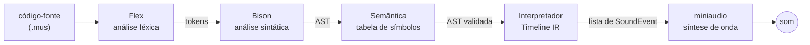

# Compilador Musical
{: .fs-9 .mb-2 }

Uma Domain-Specific Language (DSL) que transforma código em música.
{: .fs-6 .fw-300 .text-grey-dk-000 }

[Documentação]({{ site.baseurl }}){: .btn .btn-primary .mr-2 }
[Roadmap]({{ site.baseurl }}){: .btn .mr-2 }
[Relatório P2]({{ site.baseurl }}){: .btn }

---

## O que é

Este projeto é um **compilador em lote (*batch*) que traduz uma linguagem de programação própria em som**. Em vez de imprimir texto na tela, um programa escrito nesta linguagem produz música. Todo o pipeline — desde o analisador léxico até o gerador da representação intermediária e síntese de sinal — é inteiramente autoral.

É o trabalho do Grupo 03 na disciplina de **Compiladores 1** (Turma 01, Prof. Sérgio), na FCTE/UnB.

## Por que não é só um tradutor de notas

Ao aprovar a ideia, o professor colocou uma condição: a linguagem precisa ter complexidade real para valer como trabalho de Compiladores. Não basta um tradutor linear do tipo "nota X toca por tempo Y".

Por isso a linguagem suporta:

- variáveis com tipo inferido na primeira atribuição (`tempo = 0.5` declara um `numero`);
- estruturas de repetição (`repita N vezes { ... }`);
- trilhas paralelas (`{ trilha1, trilha2 }`) para polirritmia e acordes;
- análise semântica com tabela de símbolos e escopos estáticos locais;
- expressões aritméticas e lógicas, para transposição de notas e cálculo de durações;
- comentários de linha e de bloco;
- erros léxicos, sintáticos e semânticos com indicação precisa de linha e coluna;
- representação intermediária formal (Timeline) auditável via `--emit-timeline`.

## Como funciona



Uma decisão de arquitetura atravessa todo o projeto: **o núcleo do compilador não emite som**. Ele apenas produz uma lista estática de eventos temporizados —

```cpp
struct SoundEvent {
    double startTime;  // quando começa, em segundos
    double duration;   // quanto dura, em segundos
    double frequency;  // altura da nota, em Hz
    float  volume;     // amplitude, de 0.0 a 1.0
};
```

— que só depois da compilação completa é entregue ao motor de áudio. Isso mantém a lógica de linguagem separada da lógica de processamento de sinais, tornando o compilador testável sem depender de hardware de som.

## O playhead

O conceito central deste compilador é o **playhead**: um cursor de tempo que avança conforme o interpretador percorre a árvore sintática. Agendar uma nota não bloqueia a execução — apenas insere um evento na posição atual do cursor e o empurra para a frente.

É esse mecanismo que dá sentido musical às estruturas de controle:

| Construção | Efeito musical |
|---|---|
| Sequência de comandos | Notas em sequência, uma após a outra |
| Repetição | O cursor avança a cada volta, transformando laço em **padrão rítmico** |
| Condicional | Variação: caminhos diferentes produzem trechos diferentes (planejada) |
| Função | Um **motivo reutilizável**; o tempo gasto dentro dela se acumula no cursor externo (planejada) |
| Trilhas paralelas `{ a, b }` | **Vozes simultâneas**: cada trilha parte do mesmo instante com um cursor próprio, e a música continua do fim da mais longa |

As trilhas paralelas (CMP-07, #39 / ADR 002) são a forma de ter várias vozes ao mesmo tempo: cada uma tem um cursor independente, e os eventos de todas são intercalados por início numa timeline só antes do envio ao áudio.

## Um exemplo

{: .nota }
> A sintaxe abaixo é a **definida e implementada** no lexer, no parser, no analisador semântico e no interpretador.

```text
andamento 120
tempo = 0.5

repita 4 vezes {
    toca do4  por tempo
    toca mi4  por tempo
    toca sol4 por tempo
}

toca la4 - 2 por tempo * 2   /* transposição e duração calculadas */
pausa por 1.0
```

Quatro repetições de um arpejo: o mesmo trecho de código, executado quatro vezes, transforma-se em quatro compassos sonoros (pois o playhead avança a cada nota processada).

Uma versão comentada deste programa está no repositório, em `exemplos/arpejo.mus`. Para ver o analisador léxico extraindo os tokens dele, com linha e coluna de cada um:

```bash
./build/compilador --tokens exemplos/arpejo.mus
```

Para inspecionar a tabela de símbolos e checagem semântica:

```bash
./build/compilador --simbolos exemplos/arpejo.mus
```

Para emitir a representação intermediária em CSV determinístico:

```bash
./build/compilador --emit-timeline exemplos/arpejo.mus
```

E para compilar e tocar:

```bash
./build/compilador exemplos/arpejo.mus             # compila e toca
./build/compilador --no-audio exemplos/arpejo.mus  # compila sem tocar: "14 eventos, 4 s de música"
```

Um erro no programa é apontado com a posição exata, e nada chega ao áudio. O `exemplos/erros_semanticos.mus` traz um erro semântico de cada tipo, e a análise recusa todos antes de gerar qualquer evento:

```text
$ ./build/compilador exemplos/erros_semanticos.mus
[ERROR] erro semântico: Linha 14, Coluna 14: 'frase' usado antes de ser declarado ou fora de escopo
[ERROR] erro semântico: Linha 17, Coluna 1: redeclaração inválida: 'tempo' é numero, recebeu booleano
[ERROR] erro semântico: Linha 20, Coluna 14: a duração do toca espera numero, recebeu nota
[ERROR] erro semântico: Linha 21, Coluna 6: operação inválida: nota + nota
[ERROR] erro semântico: Linha 24, Coluna 14: 'compasso' usado antes de ser declarado ou fora de escopo
```

### As decisões de sintaxe

| Assunto | Decisão |
|---|---|
| Idioma | Português, de ponta a ponta |
| Notas | `do re mi fa sol la si`, com `#` para sustenido e `b` para bemol |
| Oitava | Colada na nota: `do4` é o dó central (MIDI 60), `la4` é o lá de 440 Hz |
| Sem oitava | `toca do` usa a oitava corrente, definida por `oitava 4` |
| Duração | Em **tempos**: `1.0` é uma semínima, `0.5` uma colcheia. O BPM converte para segundos |
| Separador | A palavra **`por`** separa altura de duração: `toca do4 por tempo` |
| Trilhas Paralelas | `{ trilha1, trilha2 }` para vozes simultâneas e polirritmia |
| Comentários | `//` até o fim da linha e `/* */` em bloco |
| Blocos | Delimitados por `{ }` |

A palavra-chave `por` é obrigatória. Sem ela, a instrução `toca la4 - 2 tempo` seria ambígua: o parser não teria como saber se `- 2` pertence à altura ou é o começo da duração. Com o separador, os dois lados aceitam expressão à vontade e a gramática fica sem nenhum conflito de shift/reduce.

## Stack

| Camada | Escolha |
|---|---|
| Implementação | C++17 |
| Análise léxica | Flex |
| Análise sintática | Bison |
| Análise semântica | Tabela de Símbolos com escopos estáticos e checagem de tipos |
| Código intermediário | Timeline linear de quádruplas (SoundEvents) governada por 6 invariantes |
| Áudio | miniaudio (single-header, sintetiza a forma de onda) |
| Build | CMake |
| Testes | doctest (409 casos) + CTest (22 testes), rodando no CI em Linux e macOS, com jobs de ASan e TSan |
| Plataformas | Windows (via WSL), Linux e macOS |

## Estado atual (P2 — Sprint 04)

Ao término da Sprint 04, o compilador atinge a maturidade exigida para o **Ponto de Controle 2 (P2)**:

- **Front-end e Gramática:** `lexer.l` e `parser.y` sem conflitos shift/reduce, formalizados na [Gramática EBNF]({{ site.baseurl }}), com limite determinístico de profundidade na AST (256 níveis via CMP-08).
- **Análise Semântica:** Módulo semântico completo com verificação estática de tipos, inferência na primeira atribuição, resolução de escopo em blocos `{ }` e emissão inspecionável via flag `--simbolos`.
- **Trilhas Paralelas:** Suporte a polirritmia e acordes via `{ trilha1, trilha2 }` (CMP-07 / ADR 002), com escopos isolados por trilha.
- **Representação Intermediária (IR):** Timeline formalizada com 6 invariantes e exportação determinística em CSV via flag `--emit-timeline`.
- **Áudio:** Pipeline lock-free SPSC com envelopes anti-clique de 5 ms e limitador suave (*soft-clipper*) no master bus (DSP-10).
- **Garantia de Qualidade e CI:** 409 casos doctest e 22 testes no CTest, com a suíte de integração ponta a ponta (`INT-06`) e o teste de estresse batch (`INT-07`), que compila e enfileira até 1 milhão de eventos. AddressSanitizer e ThreadSanitizer rodam em todo PR, sem erros de memória nem corridas detectados nos testes.

O relatório formal de evidências está disponível no [Relatório P2]({{ site.baseurl }}), as decisões arquiteturais nas [ADRs]({{ site.baseurl }}) e o planejamento futuro no [Roadmap]({{ site.baseurl }}).
