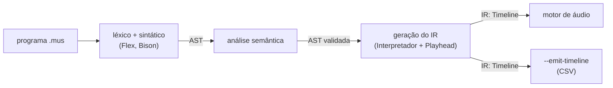

# Representação Intermediária (IR): a `Timeline`

O guia de projeto de compilador da disciplina prevê, depois da análise semântica, uma etapa de **geração de código intermediário**: converter a árvore sintática numa representação mais simples, como o código de três endereços, independente da sintaxe da linguagem-fonte. No nosso compilador, esse papel é da **`Timeline`**, uma sequência de eventos sonoros `SoundEvent` totalmente resolvidos.

Este documento especifica o IR: a estrutura, as unidades, as invariantes, as regras de tradução da AST e a relação com o código de três endereços.



---

## 1. Estrutura

### 1.1. `SoundEvent` — uma instrução do IR

Definido em `src/core/sound_event.h`:

| Campo | Tipo C++ | Unidade | Significado |
|---|---|---|---|
| `startTime` | `double` | segundos | instante em que o som começa, contado do início da peça |
| `duration` | `double` | segundos | por quanto tempo o som dura |
| `frequency` | `double` | Hz | altura do som; **0 indica pausa** |
| `volume` | `float` | ganho de 0 a 1 | intensidade do som; **0 na pausa** |

Os tempos ficam em `double` porque são acumulados ao longo da peça inteira, e um `float` perderia resolução depois de alguns minutos. O volume é `float` porque não acumula: é só um ganho por evento.

O `SoundEvent` é trivialmente copiável e de layout padrão (verificado por `static_assert`). É isso que permite que ele atravesse o *ring buffer* lock-free até a thread de áudio sem alocar memória.

### 1.2. `Timeline` — o programa no IR

Definida em `src/core/playhead.h`: um `std::vector<SoundEvent>` na ordem em que o interpretador emitiu os eventos, com `add()`, `events()`, `sortByStartTime()` (ordenação **estável** por `startTime`) e `duration()` (instante em que o último evento termina).

### 1.3. O que o IR **não** contém

O IR é independente da sintaxe da linguagem-fonte. Nenhum destes elementos chega até ele:

| Elemento da linguagem | O que acontece na tradução |
|---|---|
| variáveis (`tempo = 0.5`) | substituídas pelo valor no momento do uso |
| expressões (`la4 - 2`, `tempo * 2`) | avaliadas; só o resultado entra no evento |
| nomes de nota (`do4`, `sib3`) | convertidos em frequência (Hz) |
| `oitava` corrente | aplicada às notas sem oitava escrita; não aparece no IR |
| `volume` corrente | copiado para o campo `volume` de cada nota |
| `andamento` (BPM) | usado para converter tempos em segundos; não aparece no IR |
| `repita N vezes { }` | desenrolado em N cópias do corpo |
| comentários, chaves, `por`, `vezes` | descartados já no parser |

Por isso dois programas escritos de formas diferentes, mas com a mesma música, geram exatamente o mesmo IR (ver a seção 5).

---

## 2. Invariantes

Toda `Timeline` gerada a partir de um programa aceito pelo compilador satisfaz:

| # | Invariante | Quem garante |
|---|---|---|
| **I1** | Todo campo é um número finito (sem `NaN` nem infinito). | Interpretador: duração pela MAT-04 (#112); volume pela COMP-A |
| **I2** | `startTime ≥ 0` e `duration ≥ 0`. | `Playhead` (o cursor começa em 0 e nunca anda para trás) e MAT-04 (#112) |
| **I3** | `0 ≤ volume ≤ 1`. | `executarVolume` recusa valores fora do intervalo |
| **I4** | `frequency > 0` numa nota; uma pausa tem `frequency == 0` **e** `volume == 0`. | `executarToca` (a frequência vem de `440 · 2^((midi − 69)/12)`, sempre positiva) e `executarPausa` |
| **I5** | Na ordem de emissão, `startTime` é não decrescente. | uma única voz: cada evento começa no cursor, que só avança |
| **I6** | Voz única e contígua: cada evento começa onde o anterior termina. A peça dura a soma das durações. | toda nota e toda pausa avançam o cursor exatamente pela própria duração |

Um programa que violaria alguma invariante é recusado com **erro de execução** (o terceiro tipo de erro, depois do sintático e do semântico), e nenhum IR é produzido. São casos que a análise semântica não consegue ver, porque dependem do valor calculado e não do tipo:

| Programa | Erro |
|---|---|
| `volume 1.5` ou `volume 1 - 2` | volume precisa estar entre 0 e 1 |
| `andamento 0` | andamento precisa ser positivo |
| `repita 0 - 1 vezes { ... }` | repita precisa de uma quantidade não negativa |
| `toca do4 por 0 - 1` | duração inválida (com a MAT-04, #112) |

Limitações conhecidas:
- Uma altura extrema ainda passa sem erro. `toca 1 / 0 por 1` gera frequência infinita, o que viola I1, e `toca 0 - 20000 por 1` gera 0 Hz com volume 1, o que viola I4. A checagem (altura finita e frequência positiva) pertence ao `executarToca`, que a MAT-04 (#112) está alterando, e por isso ficou fora desta issue.
- Duração zero é permitida (I2 usa `≥`): `toca do4 por 0` gera um evento que não soa.

As invariantes I1 a I6 são verificadas automaticamente em todos os exemplos do repositório por `tests/test_representacao_intermediaria.cpp`.

---

## 3. Tradução da AST para o IR

A tradução é feita por `Interpretador::executar` (`src/interpreter/interpreter.cpp`), que percorre a AST já validada pela análise semântica. Durante a tradução, o compilador mantém um **estado de compilação**, que não faz parte do IR:

| Estado | Valor inicial | Alterado por |
|---|---|---|
| cursor (`Playhead`) | 0 | `toca`, `pausa` |
| andamento | 120 BPM | `andamento` |
| oitava corrente | 4 | `oitava` |
| volume corrente | 1.0 | `volume` |
| tabela de variáveis | vazia | atribuição |

### 3.1. Regras por comando

Notação: `⟦e⟧` é o valor da expressão `e` avaliada no estado atual; `agora` é a posição do cursor em segundos; `s(b) = b · 60 / andamento` converte tempos em segundos.

| Comando | Eventos emitidos | Efeito no estado |
|---|---|---|
| `x = e` | nenhum | `x ← ⟦e⟧` |
| `toca a por d` | `{agora, s(⟦d⟧), 440 · 2^((⟦a⟧ − 69)/12), volume}` | cursor avança `⟦d⟧` tempos |
| `pausa por d` | `{agora, s(⟦d⟧), 0, 0}` | cursor avança `⟦d⟧` tempos |
| `andamento e` | nenhum | `andamento ← ⟦e⟧`; os segundos já decorridos ficam congelados numa âncora, então nenhum evento anterior muda |
| `oitava e` | nenhum | `oitava ← ⟦e⟧`, truncado para inteiro |
| `volume e` | nenhum | `volume ← ⟦e⟧`, se estiver em [0, 1] |
| `repita n vezes { B }` | os eventos de B, repetidos | B é executado `⌊⟦n⟧⌋` vezes, **reavaliado a cada volta** |

### 3.2. Expressões

- **Nota:** `nota com oitava o` vale o MIDI `(o + 1) · 12 + semitom`, com o acidente já aplicado pelo lexer (`do4 = 60`, `la4 = 69`). Uma nota sem oitava escrita usa a oitava corrente **no momento da avaliação**.
- **Aritmética** (`+ - * /`, menos unário) sobre números, ou nota ± número (transposição em semitons). Os tipos já foram conferidos pela análise semântica, que recusa, por exemplo, `nota + nota` e `-nota`.
- **Variáveis** são resolvidas na tabela no momento do uso. Por isso uma reatribuição dentro de um `repita` vale a partir da volta em que rodou (ver `tests/ir/repeticao.mus`).

### 3.3. Pré-condição: análise semântica concluída

No `main.cpp`, a geração do IR só começa depois que a análise semântica aceita o programa inteiro. Um programa com erro léxico, sintático ou semântico nunca chega ao interpretador, e portanto nunca produz IR.

### 3.4. Exemplo comentado

```
andamento 120                // estado: 120 BPM → 1 tempo = 0.5 s
volume 0.8                   // estado: volume 0.8
tempo = 0.5                  // estado: tempo ← 0.5

repita 4 vezes {             // desenrolado: 4 cópias
    toca do4  por tempo      // {0.00, 0.25, 261.63, 0.8}, cursor 0.5 tempo
    toca mi4  por tempo      // {0.25, 0.25, 329.63, 0.8}
    toca sol4 por tempo      // {0.50, 0.25, 392.00, 0.8}
}                            // ... mais 3 voltas, até o evento 12

toca la4 - 2 por tempo * 2   // ⟦la4 - 2⟧ = 67 (sol4); ⟦tempo * 2⟧ = 1 tempo
                             // {3.00, 0.50, 392.00, 0.8}
pausa por 1.0                // {3.50, 0.50, 0, 0}
```

O IR completo, gerado por `./build/compilador -q --emit-timeline exemplos/arpejo.mus`, está em `tests/emit_timeline/arpejo.csv`.

---

## 4. Relação com o código de três endereços

O código de três endereços (3AC) representa um programa como uma sequência de instruções simples, cada uma com no máximo três operandos, geralmente guardadas como **quádruplas** `(op, arg1, arg2, resultado)`. Ele tem temporários, rótulos e desvios porque a máquina-alvo vai executar o controle de fluxo.

No nosso caso, a "máquina-alvo" é o motor de áudio, que não executa controle de fluxo nenhum: ele só precisa saber **quando** cada som começa, **quanto** dura, **qual** frequência e **com que** intensidade. Como um programa `.mus` é finito e não lê entrada, todo valor é conhecido durante a compilação. O compilador pode, então, fazer todo o trabalho:

| No 3AC clássico | No nosso IR |
|---|---|
| instrução = quádrupla `(op, arg1, arg2, res)` | instrução = quádrupla `(início, duração, frequência, volume)`, com operação implícita "soar" |
| temporários `t1 = a + b` | avaliados durante a compilação (*constant folding* completo) |
| rótulos e desvios (`if … goto`) para laços | laços desenrolados (*loop unrolling* completo) |
| variáveis em memória | substituídas pelos valores (*constant propagation*) |
| ordem de execução = ordem das instruções | ordem = `startTime`, estável entre eventos simultâneos |

Para comparar, este trecho:

```
nota = do4
repita 2 vezes { toca nota por 1
                 nota = nota + 2 }
```

em 3AC seria algo como:

```
    nota = 60
    i = 0
L1: if i >= 2 goto L2
    t1 = 440 * pow(2, (nota - 69) / 12)
    soar agora, 0.5, t1, 1.0
    agora = agora + 0.5
    nota = nota + 2
    i = i + 1
    goto L1
L2:
```

e no nosso IR é só:

```
indice,inicio_s,duracao_s,frequencia_hz,volume
1,0.000000,0.500000,261.625565,1.000000
2,0.500000,0.500000,293.664768,1.000000
```

Ou seja, o IR equivale a um código de três endereços **depois** de dobrar todas as constantes e desenrolar todos os laços: uma sequência linear de instruções sem operandos simbólicos. Essa é a forma mais simples que o backend consegue consumir, e é por isso que o motor de áudio pode tocá-la amostra a amostra, dentro do callback, sem nenhuma decisão em tempo de execução.

Essa escolha tem um limite conhecido: o tamanho do IR cresce com a duração da música (um `repita 1000 vezes` gera mil cópias). Para programas finitos escritos à mão, isso é aceitável.

---

## 5. Exemplos verificáveis

Cada caso tem o programa e o IR esperado, conferido à mão contra as regras da seção 3. O CTest roda o executável com `--emit-timeline` e compara a saída byte a byte (formato descrito em [Visão de Arquitetura]({{ site.baseurl }})).

| Caso | O que demonstra |
|---|---|
| `tests/ir/notas_e_pausas.mus` | conversão de notas e acidentes em Hz, pausa como evento silencioso, oitava corrente × oitava escrita |
| `tests/ir/andamento.mus` | troca de BPM no meio da peça: os eventos anteriores não mudam, e a timeline continua contígua |
| `tests/ir/repeticao.mus` | `repita` desenrolado, variável reatribuída dentro do laço, laço aninhado, zero voltas |
| `tests/ir/expressoes.mus` | variáveis e expressões avaliadas na compilação, precedência, volume calculado |
| `tests/ir/volume_invalido.mus` | um programa que violaria I3 é recusado, sem IR |
| `exemplos/escala.mus`, `exemplos/arpejo.mus` | os programas de referência do repositório |

Os eventos simultâneos (`startTime` iguais) são suportados pelo IR, com ordem estável na emissão, mas ainda não são gerados pela linguagem, porque não há acorde nem trilhas paralelas. O comportamento é coberto por `tests/test_timeline_emit.cpp` com uma `Timeline` montada diretamente.

A independência da sintaxe é verificada em `tests/test_representacao_intermediaria.cpp`, com pares de programas diferentes que precisam gerar o mesmo IR:
- uma variável e o literal correspondente;
- um `repita` e o mesmo corpo escrito N vezes;
- uma nota sem oitava e a mesma nota com a oitava escrita;
- 1 tempo a 60 BPM e 2 tempos a 120 BPM.

---

## 6. Referências no código

| Arquivo | Conteúdo |
|---|---|
| `src/core/sound_event.h` | a instrução do IR |
| `src/core/playhead.h` / `.cpp` | `Timeline` e o cursor que converte tempos em segundos |
| `src/interpreter/interpreter.cpp` | a tradução AST → IR |
| `src/core/timeline_emit.h` / `.cpp` | a serialização do IR em CSV (`--emit-timeline`) |
| `tests/ir/`, `tests/emit_timeline/` | exemplos com IR esperado |
| `tests/test_representacao_intermediaria.cpp` | invariantes e independência da sintaxe |
