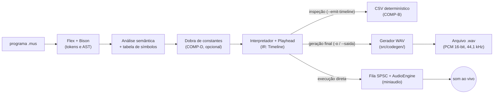

# Saída-Alvo Musical: WAV PCM 16-bit (COMP-C)

Este documento especifica a etapa de **geração de código final** do Compilador Musical (COMP-C, #108): a escolha do formato-alvo, a justificativa técnica frente às alternativas, o contrato do arquivo gerado a partir da representação intermediária (`Timeline`), a interface de linha de comando e as instruções para reprodução independente sem repetir a análise do código-fonte `.mus`.

---

## 1. Posição no pipeline do compilador

Seguindo a separação de fases prevista no guia da disciplina, o programa `.mus` é analisado em lote (*batch*) até a geração da `Timeline` (IR), e somente a partir dessa IR ocorre a geração do artefato musical final:



A geração de saída-alvo vive em `src/codegen/gerador_wav.{h,cpp}` (`namespace mus::codegen`). Ela recebe exclusivamente a `Timeline` já produzida pelo interpretador (e, quando aplicável, o `SampleBank` já carregado) e sintetiza o sinal offline usando o mesmo núcleo DSP (`AudioEngine::render`) da execução ao vivo, sem reabrir o `.mus`, sem passar pelo lexer/parser e sem inicializar dispositivo de áudio do sistema operacional.

---

## 2. Análise de alternativas e escolha do formato

Antes da implementação, três formatos-alvo possíveis foram avaliados em relação às capacidades da linguagem e às restrições do compilador:

| Critério | **WAV PCM 16-bit offline** (escolhido) | Standard MIDI File (`.mid`) | Arquivo próprio de eventos |
|---|---|---|---|
| **Fidelidade à DSL** | **Total** — preserva notas, microtons/expressões (`la4 + 0.5`), volume contínuo, polifonia e samples WAV (`INT-05`) | **Parcial** — alturas são quantizadas em 128 semitons inteiros (ou exigem pitch bend por canal) e samples WAV externos não são representáveis no `.mid` | **Total** na camada simbólica, mas apenas duplica a IR |
| **Consumo independente** | **Universal** — qualquer player de sistema operacional, navegador ou ferramenta de áudio reproduz diretamente sem executar o compilador | **Depende de sintetizador** externo ou SoundFont; o timbre varia por máquina | **Depende do nosso executável** para tocar ou converter |
| **Distinção da COMP-B** | **Clara** — a COMP-B (`--emit-timeline`) já serializa a lista simbólica de eventos em CSV; o `.wav` materializa a etapa final de execução sonora | Simbólico intermediário | Muito próximo da serialização em CSV da COMP-B |
| **Determinismo** | **Determinístico** na mesma plataforma e independente de dispositivo de som ou placa de áudio | Determinístico no arquivo, não no áudio reproduzido | Determinístico |
| **Complexidade e portabilidade** | **Baixa** — cabeçalho RIFF/WAVE padrão de 44 bytes sem dependências externas adicionais | Média — encoding variable-length quantity (VLQ), tracks e meta-eventos | Baixa, porém exige novo subcomando de leitura |

### Decisão técnica

Foi escolhido **WAV PCM 16-bit linear little-endian, mono, 44 100 Hz**, renderizado offline a partir da `Timeline`. Essa escolha:

1. **Preserva 100% da semântica da linguagem:** suporta frequências contínuas em Hz (inclusive transposições fracionárias), volume contínuo, trilhas paralelas polifônicas (`{ , }`) e samples PCM carregados pela `INT-05`.
2. **Materializa a independência de compilação e execução:** o arquivo `.wav` gerado contém a música pronta e pode ser reproduzido em qualquer ambiente (Linux, WSL, macOS, Windows ou CI sem hardware de som) sem reexecutar lexer, parser ou interpretador.
3. **Evita divergência entre geração e reprodução ao vivo:** o gerador reutiliza exatamente `carregarFila`, `segundosParaFrame` e `AudioEngine::render` — incluindo a síntese por wavetable senoidal (DSP-08), envelopes lineares adaptativos de até 5 ms (DSP-123), *voice stealing* com *fade-out* de 2 ms, interpolação linear de samples e o limitador no master bus (`softClipBuffer`).

---

## 3. Especificação do formato WAV gerado

O arquivo segue a especificação canônica **RIFF/WAVE** sem chunks extras, com cabeçalho fixo de **44 bytes** em *little-endian* seguido pelas amostras PCM:

| Offset (bytes) | Tamanho | Campo | Valor fixo / fórmula | Descrição |
|---:|---:|---|---|---|
| `0` | 4 | `ChunkID` | `"RIFF"` (`0x52494646`) | Identificador do contêiner RIFF |
| `4` | 4 | `ChunkSize` | `36 + Subchunk2Size` | Tamanho restante do arquivo em bytes |
| `8` | 4 | `Format` | `"WAVE"` (`0x57415645`) | Formato WAVE |
| `12` | 4 | `Subchunk1ID` | `"fmt "` (`0x666D7420`) | Início do descritor de formato |
| `16` | 4 | `Subchunk1Size` | `16` | Tamanho do bloco `fmt ` para PCM |
| `20` | 2 | `AudioFormat` | `1` | PCM linear sem compressão |
| `22` | 2 | `NumChannels` | `1` | Canal único (mono) |
| `24` | 4 | `SampleRate` | `44100` | Taxa de amostragem em Hz |
| `28` | 4 | `ByteRate` | `88200` | `44100 * 1 * 2` bytes por segundo |
| `32` | 2 | `BlockAlign` | `2` | `1 * 2` bytes por frame |
| `34` | 2 | `BitsPerSample` | `16` | Resolução de 16 bits por amostra |
| `36` | 4 | `Subchunk2ID` | `"data"` (`0x64617461`) | Início dos dados PCM |
| `40` | 4 | `Subchunk2Size` | `totalFrames * 2` | Número de bytes de amostras |
| `44` | `2 * N` | `Data` | `int16_t` little-endian | Amostras PCM assinadas em `[-32767, 32767]` |

A quantidade total de frames é calculada pela regra única `segundosParaFrame(timeline.duration(), 44100)` (`src/core/frames.h`). Cada amostra `float` produzida pelo master bus passa por saturação `[-1.0, 1.0]` e conversão simétrica `llround(amostra * 32767.0)` em `mus::codegen::floatParaPcm16`.

### Mapeamento das propriedades musicais da IR

| Propriedade da IR (`SoundEvent`) | Como aparece na saída WAV |
|---|---|
| **`startTime` e `duration`** | Convertidos em índices absolutos de frame via `segundosParaFrame(startTime, 44100)` e `segundosParaFrame(endTime(), 44100)`, garantindo ausência de drift acumulado e continuidade sem lacunas entre notas consecutivas. |
| **`frequency` (`Synth`)** | Síntese via wavetable de seno com interpolação linear (`src/audio/wavetable.h`, DSP-08) na frequência exata em Hz (`440 * 2^((midi - 69)/12)`), suportando inclusive alturas não temperadas ou fracionárias. |
| **`sampleId` (`Sample`)** | Leitura do buffer decodificado em `SampleBank` com interpolação linear para adaptação de taxa de amostragem (`sampleRate -> 44100`). |
| **`volume`** | Ganho escalar da voz (`0.0` a `1.0`), modulado por envelopes lineares de até 5 ms (adaptados proporcionalmente para notas curtas conforme DSP-123) e limitado no master bus (`softClipBuffer`). |
| **Pausas (`frequency == 0, volume == 0`)** | Não alocam voz ativa; avançam a linha do tempo mantendo silêncio (`0`) nos frames correspondentes. |
| **Simultaneidade (`{ trilha1, trilha2 }`)** | Eventos ordenados estavelmente por `startTime` são disparados no mesmo frame e somados no barramento mono (até 32 vozes simultâneas; acima disso aplica *voice stealing* com *fade-out* anti-clique de 2 ms). |

---

## 4. Interface de linha de comando e uso

A geração da saída-alvo é acionada pelas flags `-o <arquivo>` ou `--saida <arquivo>`:

```bash
./build/compilador -o saida.wav programa.mus
./build/compilador --saida saida.wav programa.mus
```

Regras da interface:

- Compila o `.mus`, executa análise semântica, aplica a dobra de constantes (salvo se `--sem-otimizacao` for passada), gera a `Timeline` e grava o arquivo WAV **sem inicializar o dispositivo de áudio**.
- Pode ser combinada com `--no-audio`, `--sem-otimizacao` e `--emit-timeline`.
- Não pode ser combinada com `--tokens`, `--simbolos`, `--demo`, `--loop` ou `--test-tone` (erro de uso com código de saída `2`).
- Exige caminho não vazio (erro de uso com código de saída `2` se omitido).
- Em caso de erro léxico, sintático, semântico, de execução, timeline vazia inválida ou falha ao abrir/gravar o destino, o compilador encerra com código `1`, exibe mensagem clara em `stderr` e **não deixa arquivo WAV parcial** no disco.

### Exemplos práticos de entrada e saída

Os `.wav` não ficam versionados no repositório (são ~1,3 MB binários cujo conteúdo varia a cada evolução da cadeia DSP). Eles podem ser gerados sob demanda a partir dos programas de referência em `exemplos/` (ou distribuídos como anexos de release):

| Entrada (`.mus`) | Saída sugerida (`.wav`) | Duração | Frames (`44 100 Hz`) | Tamanho exato |
|---|---|---:|---:|---:|
| `exemplos/escala.mus` | `escala.wav` | `5,4 s` | `238 140` | `476 324 bytes` |
| `exemplos/arpejo.mus` | `arpejo.wav` | `4,0 s` | `176 400` | `352 844 bytes` |
| `exemplos/polirritmia.mus` | `polirritmia.wav` | `6,0 s` | `264 600` | `529 244 bytes` |

Para gerar localmente:

```bash
./build/compilador -o escala.wav exemplos/escala.mus
./build/compilador -o arpejo.wav exemplos/arpejo.mus
./build/compilador -o polirritmia.wav exemplos/polirritmia.mus
```

### Reproduzindo o resultado sem repetir o parsing

Depois de gerado, o `.wav` é autônomo e pode ser reproduzido em qualquer ferramenta de áudio:

```bash
# Linux (ALSA / PulseAudio / FFmpeg)
aplay arpejo.wav
paplay arpejo.wav
ffplay -autoexit -nodisp arpejo.wav

# macOS
afplay arpejo.wav

# Windows (PowerShell)
(New-Object Media.SoundPlayer "arpejo.wav").PlaySync()
```

---

## 5. Testes e garantias

A geração da saída-alvo é verificada em dois níveis:

1. **Suíte unitária e espectral (`tests/test_gerador_wav.cpp` e `tests/test_options.cpp`):**
   - Validação de `floatParaPcm16` (faixa normal, saturação e não finitos) e do cabeçalho RIFF/WAVE de 44 bytes (inclusive para `Timeline` vazia).
   - Verificação espectral com **algoritmo de Goertzel** sobre escala (`escala.mus`), programa com repetições e pausa final (`arpejo.mus`), mudanças de andamento, pausas intermediárias, microtons (`la4 + 0.5`), proporção de volumes e acordes/polirritmia (`polirritmia.mus`).
   - Comparação evento a evento contra a `Timeline` (IR), reprodução de samples WAV (`INT-05`), releitura independente do `.wav` via `AudioBuffer::loadFromFile` sem passar pelo parser, determinismo com/sem dobra de constantes (`COMP-D`) e tratamento de falhas sem criar arquivo parcial.
2. **Testes de interface pela CLI (`tests/saida_wav/verifica.cmake` no CTest):**
   - `saida_wav_escala`, `saida_wav_arpejo` e `saida_wav_polirritmia` executam o binário `compilador` com `-o` e `--sem-otimizacao --saida`, validando código de saída `0`, `stdout` vazio, assinatura `RIFF`/`WAVE`, tamanho exato `44 + 2 * frames` e igualdade de hash **SHA-256** entre as duas execuções.
   - `saida_wav_recusa_erro_sintaxe`, `saida_wav_recusa_erro_semantico` e `saida_wav_recusa_caminho_invalido` confirmam saída com erro e ausência de artefato em disco.

---

## 6. Limitações conhecidas

- **Limite de 4 GiB do formato RIFF/WAVE:** como `ChunkSize` e `Subchunk2Size` usam inteiros de 32 bits sem sinal, o limite máximo é de `2 147 483 629` frames (~13,5 horas a 44 100 Hz). Timelines maiores são recusadas com mensagem explícita antes de abrir o arquivo.
- **Saída fixa em mono, 44 100 Hz, 16 bits:** alinhada à configuração interna atual do `AudioEngine`.
- **Diferenças de 1 ULP entre bibliotecas matemáticas (`libm`):** a síntese usa a wavetable senoidal (`src/audio/wavetable.h`, inicializada com `std::sin` e consultada com interpolação linear) e o limitador do master bus (`std::tanh`); entre arquiteturas ou sistemas operacionais distintos (ex.: Linux `glibc` vs macOS `libSystem`), o arredondamento dessas funções na inicialização da tabela ou na compressão pode divergir em ±1 LSB em amostras isoladas, sem efeito audível. O determinismo bit a bit é garantido dentro do mesmo ambiente.
